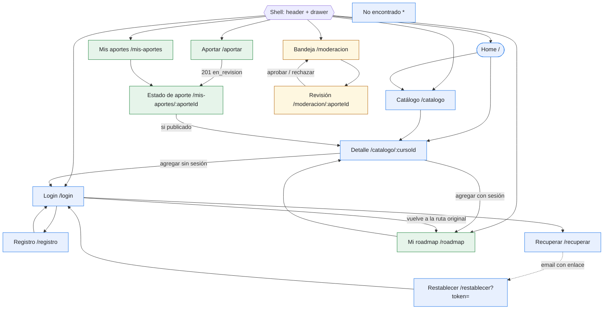

# APPFlow — Mapa del sitio y flujos de usuario — Rumbo

> **Qué es:** el esqueleto de navegación. Sitemap, rutas, ficha por pantalla y flujos de usuario
> de punta a punta. Es el puente entre el [PRD](PRD.md) (qué quiere el usuario) y el
> [BackendSchema](BackendSchema.md) (qué API lo sostiene).
> **Regla de coherencia:** cada endpoint citado acá existe con el mismo verbo y ruta en
> [BackendSchema §3.0](BackendSchema.md#índice-de-endpoints); el código `Exx` entre paréntesis
> remite a ese índice.

## 1. Sitemap

> Azul: pública · Verde: requiere sesión · Amarillo: requiere rol `moderador` o `admin`.

## 2. Rutas

| Ruta | Pantalla | Requiere login | Rol | Notas |
|------|----------|----------------|-----|-------|
| `/` | Home | no | — | buscador, 6 cursos recientes, CTA aportar/registrarse |
| `/catalogo` | Catálogo comunitario (paginado) | no | — | filtros en query string: `q`, `categoria_id`, `con_certificado`, `con_examen`, `con_cuestionarios`, `con_aval`, `orden`, `page` |
| `/catalogo/:cursoId` | Detalle de curso | no | — | `:cursoId` entero |
| `/login` | Login | no | — | acepta `?volver=/ruta` (solo rutas internas que empiezan con `/`); con sesión redirige a `/roadmap` |
| `/registro` | Registro | no | — | con sesión redirige a `/roadmap` |
| `/recuperar` | Solicitar recuperación | no | — | |
| `/restablecer` | Nueva contraseña | no | — | requiere `?token=`; sin token muestra el estado "enlace inválido" |
| `/roadmap` | Mi roadmap | sí | usuario | filtro `?estado=`, `?page=` |
| `/aportar` | Formulario de aporte | sí | usuario | |
| `/mis-aportes` | Mis aportes | sí | usuario | filtro `?estado=`, `?page=` |
| `/mis-aportes/:aporteId` | Estado de mi aporte | sí | usuario (autor) | |
| `/moderacion` | Bandeja de moderación | sí | moderador / admin | `?page=` |
| `/moderacion/:aporteId` | Revisión de aporte | sí | moderador / admin | |
| `*` | No encontrado | no | — | link a `/` y a `/catalogo` |

**Guardas de ruta (frontend):** `RutaProtegida` (sin sesión → `/login?volver=<ruta actual>`) y
`RutaConRol` (sesión sin rol suficiente → pantalla "No tenés permiso para ver esta sección").
La seguridad real está en el backend; la guarda solo evita mostrar pantallas inútiles.

## 3. Fichas de pantalla

### 3.0 Shell (presente en todas las pantallas)

- **Objetivo:** navegar entre secciones y conocer el estado de la sesión.
- **Componentes (UX-UI):** header sticky (§5), botón hamburguesa + drawer (§4.6) en < 1024px, nav
  horizontal en ≥ 1024px, menú de cuenta, snackbar global (§4.8).
- **Ítems de navegación:** Inicio · Catálogo · Mi roadmap\* · Aportar curso\* · Mis aportes\* ·
  Moderación\*\* · Ingresar / Cerrar sesión. (\* con sesión · \*\* rol moderador/admin)
- **APIs:** `GET /api/v1/auth/me` (E05) al iniciar la app (401 = visitante, no es error);
  `POST /api/v1/auth/logout` (E04) desde el menú de cuenta.
- **Estados:** `cargando sesión` (header sin acciones de cuenta, sin parpadeo) · `visitante` · `con sesión`.

### 3.1 Home (`/`)

- **Historias:** US-003.
- **Objetivo del usuario:** entender qué es Rumbo y empezar a buscar en un toque.
- **Componentes:** título + bajada, campo de búsqueda grande (envía a `/catalogo?q=…`), grilla de
  6 cards de curso, botón "Ver todo el catálogo", bloque CTA ("Aportá un curso" con sesión /
  "Creá tu cuenta" sin sesión).
- **Estados:** `loading` (6 skeleton cards) · `ok` · `empty` (todavía no hay cursos publicados:
  "El catálogo está arrancando — sé el primero en aportar") · `error` (banner con "Reintentar"; la
  búsqueda sigue funcionando).
- **APIs:** `GET /api/v1/cursos?page=1&page_size=6&orden=recientes` (E09).
- **Navegación:** hacia Catálogo, Detalle, Registro o Aportar.

### 3.2 Catálogo comunitario (`/catalogo`)

- **Historias:** US-003, US-007, US-012.
- **Objetivo del usuario:** encontrar cursos publicados que encajen con lo que busca.
- **Componentes:** campo de búsqueda, select de categoría, chips de filtro (Con certificado, Con
  examen, Con cuestionarios, Con aval), select de orden, contador "1–20 de N", grilla de cards
  (§4.3), paginador (§4.4), skeleton, empty state, banner de error.
- **Comportamiento:** cada cambio de filtro actualiza la query string y vuelve a `page=1`; la
  búsqueda se dispara al enviar o con debounce de 400 ms y mínimo 2 caracteres; volver atrás en
  el navegador restaura filtros y página; mientras carga la página siguiente se mantiene la
  anterior atenuada (sin salto de layout).
- **Acción en card:** botón "Agregar a mi roadmap" / indicador "En tu roadmap".
- **Estados:** `loading` (12 skeleton cards) · `ok` · `empty` ("No encontramos cursos con esos
  filtros" + "Limpiar filtros" + "Aportar un curso" si hay sesión) · `error` ("No pudimos cargar
  el catálogo" + "Reintentar") · `página fuera de rango` ("Esta página no existe" + "Ir a la página 1").
- **APIs:** `GET /api/v1/categorias?page=1&page_size=100` (E08) ·
  `GET /api/v1/cursos?page=…&page_size=20&q=…&categoria_id=…&con_certificado=…&con_examen=…&con_cuestionarios=…&con_aval=…&orden=…` (E09) ·
  `POST /api/v1/roadmap/items` (E18) · `DELETE /api/v1/roadmap/items/{item_id}` (E20, acción "Deshacer" del snackbar).
- **Navegación:** desde Home y menú; hacia Detalle; hacia Login si agrega sin sesión.

### 3.3 Detalle de curso (`/catalogo/:cursoId`)

- **Historias:** US-004, US-007.
- **Objetivo del usuario:** decidir si el curso le sirve y agregarlo a su roadmap.
- **Componentes:** breadcrumb "Catálogo › Categoría", título, chip de categoría, plataforma ·
  versión · año, lista de docentes, grilla de atributos con iconos (cuestionarios, examen,
  certificado, aval + organización), descripción, bloque "Aportado por {nombre} · {lo tomó / no lo
  tomó}", "{N} personas lo tienen en su roadmap", fecha de verificación del enlace, botón
  primario "Ir al curso" (pestaña nueva, `rel="noopener noreferrer"`), botón "Agregar a mi
  roadmap" o estado "En tu roadmap" con acción "Quitar".
- **Estados:** `loading` (skeleton de detalle) · `ok` · `no encontrado` (404: "Curso no
  encontrado" + "Volver al catálogo") · `error` (banner + "Reintentar").
- **APIs:** `GET /api/v1/cursos/{curso_id}` (E10) · `POST /api/v1/roadmap/items` (E18) ·
  `DELETE /api/v1/roadmap/items/{item_id}` (E20).
- **Navegación:** desde Catálogo, Home o Mi roadmap; hacia el sitio externo; hacia Login.

### 3.4 Login (`/login`)

- **Historias:** US-002.
- **Objetivo del usuario:** entrar a su cuenta.
- **Componentes:** card centrada, campos email y contraseña (con botón mostrar/ocultar),
  botón primario "Ingresar", links "¿Olvidaste tu contraseña?" y "Crear cuenta", banner de error.
- **Estados:** `default` · `enviando` (botón loading, campos deshabilitados) · `error de
  credenciales` (banner "Email o contraseña incorrectos", foco en el banner) · `bloqueado por
  rate limit` (banner con cuenta regresiva desde `reintentar_en`, botón deshabilitado) · `éxito`
  (redirige a `volver` o `/roadmap`) · aviso informativo si llega desde restablecer
  ("Contraseña actualizada, ingresá con la nueva").
- **APIs:** `POST /api/v1/auth/login` (E03).

### 3.5 Registro (`/registro`)

- **Historias:** US-001.
- **Objetivo del usuario:** crear su cuenta en menos de un minuto.
- **Componentes:** campos nombre, email, contraseña (con ayuda "Mínimo 10 caracteres" y medidor de
  largo), botón "Crear cuenta", link "Ya tengo cuenta".
- **Estados:** `default` · `validación inline` (al salir de cada campo) · `enviando` · `email
  duplicado` (error en el campo email con link "Ingresar") · `error de red` (snackbar) · `éxito`
  (snackbar "¡Bienvenida/o a Rumbo!" y redirección a `/roadmap`).
- **APIs:** `POST /api/v1/auth/registro` (E02).

### 3.6 Recuperar contraseña (`/recuperar`)

- **Historias:** US-009.
- **Componentes:** campo email, botón "Enviar enlace", link "Volver a ingresar".
- **Estados:** `default` · `enviando` · `enviado` (mensaje neutro: "Si el email está registrado,
  te enviamos un enlace. Revisá tu bandeja y el spam. El enlace vence en 30 minutos.") ·
  `rate limit` (banner con cuenta regresiva) · `error de red`.
- **APIs:** `POST /api/v1/auth/recuperar` (E06).

### 3.7 Restablecer contraseña (`/restablecer?token=…`)

- **Historias:** US-009.
- **Componentes:** campos "Nueva contraseña" y "Repetir contraseña", botón "Guardar contraseña".
- **Estados:** `default` · `contraseñas no coinciden` (validación en cliente) · `enviando` ·
  `token inválido o vencido` (400: "El enlace venció o ya fue usado" + botón "Pedir un enlace
  nuevo" → `/recuperar`) · `sin token` (mismo estado anterior) · `éxito` (redirige a `/login` con
  aviso).
- **APIs:** `POST /api/v1/auth/restablecer` (E07).
- **Seguridad:** al montar la pantalla se reemplaza la URL con `history.replaceState` para que el
  token no quede en el historial; la página no carga recursos de terceros (sin filtración por `Referer`).

### 3.8 Mi roadmap (`/roadmap`) — protegida

- **Historias:** US-008, US-011.
- **Objetivo del usuario:** ver su plan de estudio, actualizar el avance y decidir qué sigue.
- **Componentes:** título + resumen de avance ("3 de 8 completados" + barra de progreso), chips
  de filtro por estado (Todos, Pendiente, En progreso, Completado), lista ordenada de ítems
  (número de orden, título → detalle, plataforma, categoría, select de estado, botones Subir /
  Bajar, botón Quitar), paginador, modal de confirmación al quitar.
- **Comportamiento:** el cambio de estado es optimista (se revierte con snackbar de error si
  falla); Subir/Bajar se deshabilitan en los extremos del roadmap completo y mientras hay un
  filtro de estado activo (el orden es global); tras quitar, si la página queda vacía y no es la
  primera, se navega a la anterior.
- **Estados:** `loading` (skeleton de lista) · `ok` · `empty` ("Tu roadmap está vacío" + "Explorar
  el catálogo") · `empty con filtro` ("No tenés cursos en este estado" + "Ver todos") · `error`
  (banner + "Reintentar").
- **APIs:** `GET /api/v1/roadmap/items?page=…&page_size=20&estado=…` (E17) ·
  `PATCH /api/v1/roadmap/items/{item_id}` (E19) · `DELETE /api/v1/roadmap/items/{item_id}` (E20).

### 3.9 Aportar curso (`/aportar`) — protegida

- **Historias:** US-005.
- **Objetivo del usuario:** cargar un curso completo en una sola pasada sin perder lo escrito.
- **Componentes:** formulario en 4 secciones con título:
  1. **Enlace:** URL (con ayuda "Pegá el enlace a la página principal del curso").
  2. **Datos del curso:** título, tema, plataforma, categoría (select), versión, año de edición,
     docentes (campo con "Agregar otro docente", de 1 a 10, cada uno con botón quitar), descripción (opcional, contador 0/2000).
  3. **Características:** 4 grupos de radio Sí/No sin selección inicial — ¿Tiene cuestionarios?,
     ¿Requiere examen?, ¿Extiende certificado?, ¿Lo avala una organización? (si Sí, aparece el
     campo "Organización que lo avala").
  4. **Tu experiencia:** radio Sí/No "¿Tomaste este curso?" sin selección inicial.
  Botones "Enviar a revisión" (primario) y "Cancelar" (texto; si hay cambios, modal "¿Descartar el aporte?").
- **Validación:** en cliente con el mismo esquema que el backend (largos, rango de año, Sí/No
  obligatorios, BR-006); al enviar con errores, resumen de errores arriba con links a cada campo y
  foco en el resumen.
- **Estados:** `default` · `con errores` · `enviando` (botón loading, formulario de solo lectura) ·
  `URL duplicada publicada` (error en el campo URL: "Este curso ya está en el catálogo — Ver curso") ·
  `URL duplicada en revisión` (error en URL: "Ya hay un aporte en revisión con esta URL") ·
  `sesión expirada` (comportamiento global §5; el borrador del formulario se guarda en
  `sessionStorage` y se restaura al volver) · `error de red` (snackbar "No pudimos enviar el
  aporte" + "Reintentar"; los datos quedan en pantalla) · `éxito` (snackbar "Aporte enviado a
  revisión" y redirección a `/mis-aportes/:aporteId`).
- **APIs:** `GET /api/v1/categorias?page=1&page_size=100` (E08) · `POST /api/v1/aportes` (E11).

### 3.10 Mis aportes (`/mis-aportes`) — protegida

- **Historias:** US-010.
- **Componentes:** chips de filtro por estado, lista/tabla paginada (§4.4) con título, plataforma,
  fecha de envío y chip de estado; botón "Aportar un curso".
- **Estados:** `loading` · `ok` · `empty` ("Todavía no aportaste cursos" + "Aportar el primero") ·
  `empty con filtro` · `error`.
- **APIs:** `GET /api/v1/aportes/mios?page=…&page_size=20&estado=…` (E12).

### 3.11 Estado de mi aporte (`/mis-aportes/:aporteId`) — protegida

- **Historias:** US-010, US-005.
- **Componentes:** chip de estado grande, línea de tiempo (Enviado el … → Revisado el …), todos los
  datos cargados en modo lectura, bloque de motivo si `rechazado` (fondo `--color-error-container`),
  link "Ver en el catálogo" si `publicado`, botón "Aportar otro curso".
- **Estados:** `loading` · `en_revision` ("Un moderador lo va a revisar pronto") · `publicado` ·
  `rechazado` · `no encontrado` (404, incluye aportes ajenos) · `error`.
- **APIs:** `GET /api/v1/aportes/{aporte_id}` (E13).

### 3.12 Bandeja de moderación (`/moderacion`) — protegida, rol moderador/admin

- **Historias:** US-006.
- **Componentes:** título con contador "N aportes pendientes", lista/tabla paginada del más antiguo
  al más nuevo (fecha, título, plataforma, categoría, autor, "lo tomó"), marca "Tu aporte" en los
  propios, botón "Revisar" por fila.
- **Estados:** `loading` · `ok` · `empty` ("No hay aportes pendientes. ¡Todo al día!") · `sin
  permiso` (403) · `error`.
- **APIs:** `GET /api/v1/moderacion/aportes?page=…&page_size=20` (E14).

### 3.13 Revisión de aporte (`/moderacion/:aporteId`) — protegida, rol moderador/admin

- **Historias:** US-006.
- **Componentes:** todos los datos del aporte, link "Abrir enlace" (pestaña nueva), checkbox
  obligatorio "Abrí el enlace y está activo" (habilita Aprobar), botón primario "Aprobar y
  publicar", botón de peligro "Rechazar" que abre un modal con textarea de motivo (10–500,
  contador) y botones "Cancelar" / "Rechazar aporte".
- **Estados:** `loading` · `revisable` · `propio` (botones deshabilitados + "No podés moderar tus
  propios aportes") · `ya moderado` (409 o estado ≠ `en_revision`: banner "Este aporte ya fue
  moderado" + "Volver a la bandeja") · `procesando` · `éxito` (snackbar "Aporte publicado" /
  "Aporte rechazado" y vuelta a la bandeja) · `no encontrado` · `sin permiso` · `error`.
- **APIs:** `GET /api/v1/aportes/{aporte_id}` (E13) ·
  `POST /api/v1/moderacion/aportes/{aporte_id}/aprobar` (E15) ·
  `POST /api/v1/moderacion/aportes/{aporte_id}/rechazar` (E16).

### 3.14 No encontrado (`*`)

- **Componentes:** ilustración/icono, "No encontramos esta página", botones "Ir al inicio" y "Ver el catálogo".
- **APIs:** ninguna.

### 3.15 Matriz pantalla × endpoint

| Pantalla | E02 | E03 | E04 | E05 | E06 | E07 | E08 | E09 | E10 | E11 | E12 | E13 | E14 | E15 | E16 | E17 | E18 | E19 | E20 |
|----------|-----|-----|-----|-----|-----|-----|-----|-----|-----|-----|-----|-----|-----|-----|-----|-----|-----|-----|-----|
| Shell | | | ✓ | ✓ | | | | | | | | | | | | | | | |
| Home | | | | | | | | ✓ | | | | | | | | | | | |
| Catálogo | | | | | | | ✓ | ✓ | | | | | | | | | ✓ | | ✓ |
| Detalle | | | | | | | | | ✓ | | | | | | | | ✓ | | ✓ |
| Login | | ✓ | | | | | | | | | | | | | | | | | |
| Registro | ✓ | | | | | | | | | | | | | | | | | | |
| Recuperar | | | | | ✓ | | | | | | | | | | | | | | |
| Restablecer | | | | | | ✓ | | | | | | | | | | | | | |
| Mi roadmap | | | | | | | | | | | | | | | | ✓ | | ✓ | ✓ |
| Aportar | | | | | | | ✓ | | | ✓ | | | | | | | | | |
| Mis aportes | | | | | | | | | | | ✓ | | | | | | | | |
| Estado de aporte | | | | | | | | | | | | ✓ | | | | | | | |
| Bandeja moderación | | | | | | | | | | | | | ✓ | | | | | | |
| Revisión de aporte | | | | | | | | | | | | ✓ | | ✓ | ✓ | | | | |

Todos los endpoints E02–E20 tienen al menos una pantalla consumidora; E01 (`/health`) lo usa
solo el healthcheck de Docker.

## 4. Flujos de usuario

### Flujo 1 — Registro y primeros pasos (US-001, US-002, US-003)

1. Lucía entra a `/` desde un link compartido. El shell llama `GET /api/v1/auth/me` → 401 → modo visitante.
2. Home muestra 6 cursos recientes (`GET /api/v1/cursos?page=1&page_size=6&orden=recientes`).
3. Toca "Creá tu cuenta" → `/registro`.
4. Completa nombre, email y contraseña. La validación inline marca "Mínimo 10 caracteres" mientras escribe.
5. Envía → `POST /api/v1/auth/registro`.
   - **201:** el backend setea la cookie de sesión; snackbar "¡Bienvenida a Rumbo!"; redirección a `/roadmap`.
   - **409 `email_duplicado`:** error en el campo email: "Ya existe una cuenta con ese email" + link "Ingresar". Los demás campos se conservan.
   - **422:** errores por campo desde `errors[]`; foco al primer campo con error.
   - **429:** banner "Demasiados registros desde esta conexión. Probá más tarde."
   - **Error de red:** snackbar "Sin conexión. Revisá tu internet" + "Reintentar".
6. En `/roadmap` ve el empty state "Tu roadmap está vacío" y toca "Explorar el catálogo" → `/catalogo` (continúa en el Flujo 4).
7. **Rama login posterior:** otro día entra a `/login`, se equivoca 5 veces → la 6.ª respuesta es 429 con `reintentar_en: 42`; el banner muestra la cuenta regresiva y el botón se reactiva al llegar a 0.

### Flujo 2 — Aportar un curso al catálogo (US-005, US-010)

1. Lucía, con sesión, toca "Aportar curso" en el drawer → `/aportar`. Se cargan las categorías (`GET /api/v1/categorias?page=1&page_size=100`).
2. Pega la URL, completa título, tema, plataforma, categoría, versión, año, un docente; responde los 4 Sí/No de características y "¿Tomaste este curso?" = Sí.
3. Marca "¿Lo avala una organización?" = Sí → aparece "Organización que lo avala"; lo deja vacío.
4. Toca "Enviar a revisión": la validación en cliente bloquea el envío, muestra el resumen de errores y lleva el foco al campo de organización. Lo completa.
5. Reenvía → `POST /api/v1/aportes`.
   - **201:** snackbar "Aporte enviado a revisión"; redirección a `/mis-aportes/91` con estado "En revisión".
   - **409 `url_duplicada` con `estado_existente: "publicado"`:** error en URL "Este curso ya está en el catálogo" con link a `/catalogo/42`; el resto del formulario se conserva.
   - **409 `url_duplicada` con `estado_existente: "en_revision"`:** error en URL "Ya hay un aporte en revisión con esta URL".
   - **422:** errores por campo mapeados desde `errors[].campo`.
   - **401 (sesión vencida mientras completaba):** el formulario se guarda en `sessionStorage`, snackbar "Tu sesión expiró", redirección a `/login?volver=/aportar`; al volver, el formulario se restaura y se borra el borrador guardado.
   - **Error de red / 500:** snackbar "No pudimos enviar el aporte" + "Reintentar"; nada se pierde.
6. Días después vuelve a `/mis-aportes` (`GET /api/v1/aportes/mios?page=1&page_size=20`) y ve el chip "Publicado" o "Rechazado"; al abrir el rechazado (`GET /api/v1/aportes/91`) lee el motivo.

### Flujo 3 — Moderación de un aporte (US-006)

1. Martín (rol `moderador`) ve "Moderación" en el drawer y entra a `/moderacion` → `GET /api/v1/moderacion/aportes?page=1&page_size=20`. Ve "4 aportes pendientes", del más antiguo al más nuevo.
2. Toca "Revisar" en el primero → `/moderacion/91` → `GET /api/v1/aportes/91`.
3. Toca "Abrir enlace" (pestaña nueva), comprueba que el curso existe, es gratuito y que los datos coinciden.
4. **Rama aprobar:** marca "Abrí el enlace y está activo" y toca "Aprobar y publicar" → `POST /api/v1/moderacion/aportes/91/aprobar` con `{ "enlace_verificado": true }`.
   - **200:** snackbar "Aporte publicado"; vuelve a la bandeja con el contador actualizado. El curso ya aparece en `/catalogo`.
5. **Rama rechazar:** toca "Rechazar" → modal con motivo; escribe "El enlace pide pago para acceder al contenido." → "Rechazar aporte" → `POST /api/v1/moderacion/aportes/91/rechazar`.
   - **200:** snackbar "Aporte rechazado"; vuelve a la bandeja.
   - **422:** motivo menor a 10 caracteres → error bajo el textarea; el modal sigue abierto.
6. **Rama carrera:** otro moderador decidió el mismo aporte un segundo antes → **409 `aporte_ya_moderado`**: banner "Este aporte ya fue moderado" + "Volver a la bandeja".
7. **Rama aporte propio:** si `es_propio = true`, los botones están deshabilitados desde el inicio; si igual se fuerza la llamada, el backend responde **403 `autovalidacion_no_permitida`**.
8. **Rama sin permiso:** un usuario sin rol que escribe `/moderacion` en la barra ve "No tenés permiso para ver esta sección"; la API respondería 403 `sin_permiso`.

### Flujo 4 — Descubrir un curso, agregarlo al roadmap y registrar avance (US-003, US-004, US-007, US-008, US-011, US-012)

1. Lucía, sin sesión, abre `/catalogo`, escribe "sql", elige "Bases de Datos" y activa "Con certificado" → URL `/catalogo?q=sql&categoria_id=3&con_certificado=true&page=1` → `GET /api/v1/cursos?page=1&page_size=20&q=sql&categoria_id=3&con_certificado=true`.
   - **Empty:** "No encontramos cursos con esos filtros" + "Limpiar filtros".
2. Abre una card → `/catalogo/57` → `GET /api/v1/cursos/57`. Lee atributos, ve que quien lo aportó lo tomó y que 12 personas lo tienen en su roadmap.
3. Toca "Agregar a mi roadmap" sin sesión → `/login?volver=/catalogo/57`.
4. Ingresa (`POST /api/v1/auth/login`) → vuelve a `/catalogo/57`; el detalle se recarga con sesión (`roadmap_item_id: null`).
5. Toca "Agregar a mi roadmap" → `POST /api/v1/roadmap/items` con `{ "curso_id": 57 }`.
   - **201:** el botón cambia a "En tu roadmap"; snackbar "Agregado a tu roadmap" con "Deshacer" (→ `DELETE /api/v1/roadmap/items/{item_id}`) y "Ver roadmap".
   - **409 `curso_ya_en_roadmap`:** (otra pestaña ya lo agregó) se muestra "En tu roadmap" sin error.
   - **404:** el curso dejó de estar disponible → snackbar "Este curso ya no está disponible".
6. Va a `/roadmap` → `GET /api/v1/roadmap/items?page=1&page_size=20`. Ve "0 de 5 completados".
7. Cambia el estado del curso 57 a "En progreso" → `PATCH /api/v1/roadmap/items/318` con `{ "estado": "en_progreso" }` (actualización optimista; si falla, se revierte y aparece snackbar de error).
8. Toca "Subir" dos veces → `PATCH /api/v1/roadmap/items/318` con `{ "orden": 2 }` y luego `{ "orden": 1 }`; el foco queda en el ítem movido y un anuncio `aria-live` dice "Movido a la posición 1".
9. Semanas después lo marca "Completado" → el resumen pasa a "1 de 5 completados".
10. Quita un curso que ya no le interesa → modal "¿Quitar de tu roadmap?" → `DELETE /api/v1/roadmap/items/{item_id}` → 204; la lista se recarga con el orden compactado.

### Flujo 5 — Recuperación de contraseña (US-009)

1. En `/login`, Lucía toca "¿Olvidaste tu contraseña?" → `/recuperar`.
2. Escribe su email → `POST /api/v1/auth/recuperar` → **202** → mensaje neutro "Si el email está registrado, te enviamos un enlace…".
   - **429** (más de 3 pedidos en 15 min): banner con cuenta regresiva.
3. Recibe el email (en desarrollo, visible en Mailpit `http://localhost:8025`) con el enlace `http://localhost:5173/restablecer?token=…`.
4. Abre el enlace; la pantalla limpia el token de la barra de direcciones y muestra el formulario.
5. Escribe y repite la nueva contraseña → `POST /api/v1/auth/restablecer`.
   - **204:** redirección a `/login` con el aviso "Contraseña actualizada, ingresá con la nueva". Cualquier sesión abierta en otro dispositivo recibe 401 en su próxima llamada.
   - **400 `token_invalido`:** "El enlace venció o ya fue usado" + "Pedir un enlace nuevo".
   - **422:** contraseña corta o igual al email → error en el campo.
6. Ingresa con la contraseña nueva (Flujo 1, paso 7 sin la rama de rate limit).

## 5. Estados globales de la app

| Situación | Comportamiento |
|-----------|----------------|
| Arranque de la app | `GET /api/v1/auth/me`: 200 = con sesión, 401 = visitante. Hasta la respuesta, el header no muestra acciones de cuenta y las rutas protegidas muestran skeleton (no redirigen antes de saber) |
| Sin sesión y ruta protegida | Redirect a `/login?volver=<ruta original con query>` |
| Sesión expirada (401 en cualquier llamada con sesión) | Se limpia el usuario del estado global, snackbar "Tu sesión expiró. Ingresá de nuevo", redirect a `/login?volver=<ruta actual>`. En `/aportar` se guarda antes el borrador (Flujo 2) |
| Ruta de rol sin permiso (403 `sin_permiso`) | Pantalla "No tenés permiso para ver esta sección" + "Ir al inicio" (sin logout) |
| Error de red (sin respuesta) | Banner persistente bajo el header "Sin conexión. Reintentando…" mientras `navigator.onLine` sea `false`; las consultas se reintentan 2 veces con backoff (1 s, 3 s); las mutaciones no se reintentan solas: snackbar con "Reintentar" |
| Error 500 | Snackbar "Algo salió mal. Probá de nuevo en unos minutos"; en pantallas de listado, estado `error` con "Reintentar" |
| Rate limit (429) | Mensaje en contexto (banner del formulario) con cuenta regresiva usando `reintentar_en` |
| Navegación | Cada cambio de ruta mueve el foco al `<h1>` de la pantalla y actualiza `document.title` ("Catálogo · Rumbo") |

---

**Referencias:**
- NN/g — Information Architecture vs. Sitemaps: https://www.nngroup.com/articles/information-architecture-sitemaps/
- NN/g — User Journeys vs. User Flows: https://www.nngroup.com/articles/user-journeys-vs-user-flows/
