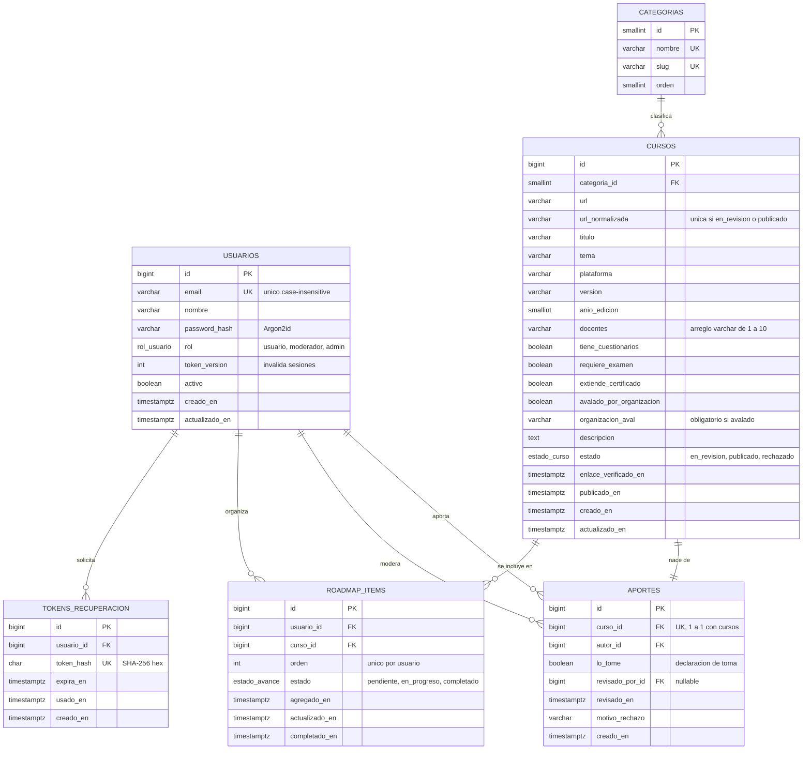
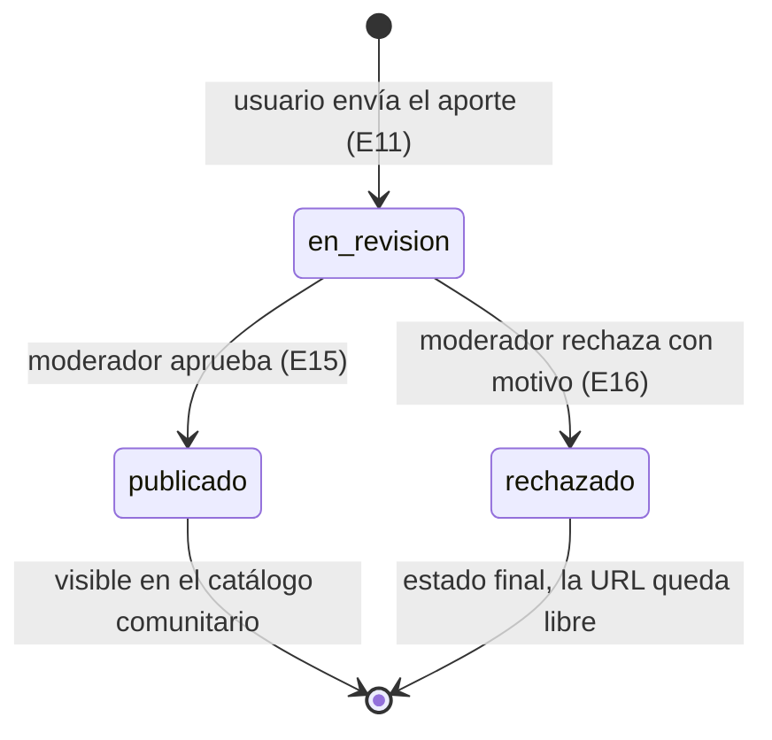
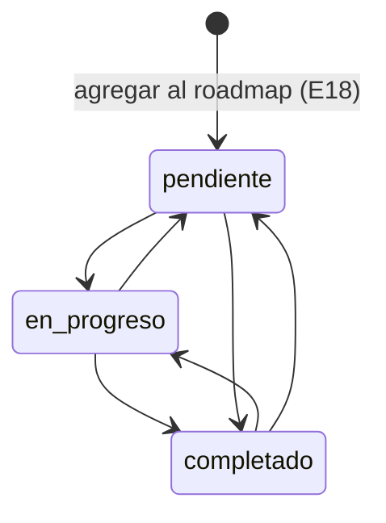

# BackendSchema — Esquema de base de datos y APIs — Rumbo

> **Qué es:** el contrato del backend: modelo de datos en PostgreSQL 18.6 + superficie de API REST.
> Hace posible el [TRD](TRD.md) y es lo que consume el [APPFlow](APPFlow.md).
> **Regla de coherencia:** todo endpoint citado en el APPFlow existe acá con el mismo verbo y la
> misma ruta (ver el índice de §3.0).

## 1. Modelo de datos

### 1.1 Diagrama entidad-relación



### 1.2 Tipos enumerados

| Tipo | Valores | Uso |
|------|---------|-----|
| `rol_usuario` | `usuario`, `moderador`, `admin` | `usuarios.rol` |
| `estado_curso` | `en_revision`, `publicado`, `rechazado` | `cursos.estado` |
| `estado_avance` | `pendiente`, `en_progreso`, `completado` | `roadmap_items.estado` |

### 1.3 Tablas

> Convenciones: PK `bigint GENERATED ALWAYS AS IDENTITY` (salvo `categorias`, `smallint`);
> timestamps `timestamptz` en UTC con `DEFAULT now()`; `actualizado_en` se actualiza en el
> repository en cada `UPDATE`; nombres en `snake_case` y en español; FKs con nombre
> `fk_<tabla>_<columna>`. Extensión requerida: `pg_trgm` (búsqueda por texto).

#### `usuarios`

| Columna | Tipo | Constraints | Notas |
|---------|------|-------------|-------|
| id | bigint identity | PK | |
| email | varchar(254) | NOT NULL | se guarda tal como se ingresó, recortado; unicidad sobre `lower(email)` |
| nombre | varchar(80) | NOT NULL, CHECK `length(trim(nombre)) >= 2` | se muestra como autor de aportes |
| password_hash | varchar(255) | NOT NULL | hash Argon2id en formato PHC (`$argon2id$v=19$m=19456,t=2,p=1$…`) |
| rol | rol_usuario | NOT NULL, DEFAULT `'usuario'` | BR-009 |
| token_version | integer | NOT NULL, DEFAULT 0, CHECK `>= 0` | se incrementa al restablecer contraseña; viaja en el JWT (`tv`) |
| activo | boolean | NOT NULL, DEFAULT true | cuenta deshabilitada no puede iniciar sesión |
| creado_en | timestamptz | NOT NULL, DEFAULT now() | |
| actualizado_en | timestamptz | NOT NULL, DEFAULT now() | |

**Índices:**
- `uq_usuarios_email_lower` UNIQUE sobre `(lower(email))` — unicidad case-insensitive y búsqueda en login.

#### `categorias`

| Columna | Tipo | Constraints | Notas |
|---------|------|-------------|-------|
| id | smallint | PK | ids fijos definidos en la migración |
| nombre | varchar(60) | NOT NULL, UNIQUE | |
| slug | varchar(60) | NOT NULL, UNIQUE, CHECK `slug ~ '^[a-z0-9-]+$'` | |
| orden | smallint | NOT NULL | orden de presentación en selects y chips |

**Datos (lista cerrada, cargada por migración):**

| id | nombre | slug |
|----|--------|------|
| 1 | Programación y Desarrollo | programacion-desarrollo |
| 2 | Datos e Inteligencia Artificial | datos-ia |
| 3 | Bases de Datos | bases-de-datos |
| 4 | Infraestructura y Cloud | infraestructura-cloud |
| 5 | Ciberseguridad | ciberseguridad |
| 6 | Diseño UX/UI | diseno-ux-ui |
| 7 | Gestión de Proyectos y Agilidad | gestion-proyectos |
| 8 | Matemática y Ciencias | matematica-ciencias |
| 9 | Idiomas | idiomas |
| 10 | Negocios y Emprendimiento | negocios-emprendimiento |
| 11 | Marketing Digital | marketing-digital |
| 12 | Habilidades Blandas | habilidades-blandas |
| 13 | Otra | otra |

#### `cursos`

| Columna | Tipo | Constraints | Notas |
|---------|------|-------------|-------|
| id | bigint identity | PK | |
| categoria_id | smallint | NOT NULL, FK → `categorias.id` ON DELETE RESTRICT | SPEC: categoría de una lista |
| url | varchar(2048) | NOT NULL, CHECK `url ~* '^https?://'` | tal como la cargó el autor; BR-007 |
| url_normalizada | varchar(2048) | NOT NULL | ver reglas de normalización en §4 |
| titulo | varchar(200) | NOT NULL, CHECK `length(trim(titulo)) >= 3` | SPEC |
| tema | varchar(120) | NOT NULL, CHECK `length(trim(tema)) >= 2` | SPEC |
| plataforma | varchar(80) | NOT NULL | decisión propia (p. ej. "Coursera", "YouTube") |
| version | varchar(40) | NOT NULL | SPEC; texto libre ("2024", "v3", "2.ª edición") |
| anio_edicion | smallint | NOT NULL, CHECK `anio_edicion BETWEEN 1990 AND 2100` | el límite superior real (año actual + 1) se valida en el service |
| docentes | varchar(120)[] | NOT NULL, CHECK `cardinality(docentes) BETWEEN 1 AND 10` | SPEC: docentes o disertantes |
| tiene_cuestionarios | boolean | NOT NULL | SPEC |
| requiere_examen | boolean | NOT NULL | SPEC |
| extiende_certificado | boolean | NOT NULL | SPEC |
| avalado_por_organizacion | boolean | NOT NULL | SPEC |
| organizacion_aval | varchar(160) | NULL, CHECK `(avalado_por_organizacion AND organizacion_aval IS NOT NULL) OR (NOT avalado_por_organizacion AND organizacion_aval IS NULL)` | BR-006 |
| descripcion | varchar(2000) | NULL | opcional |
| estado | estado_curso | NOT NULL, DEFAULT `'en_revision'` | ver §2 |
| enlace_verificado_en | timestamptz | NULL | se completa al aprobar (BR-007) |
| publicado_en | timestamptz | NULL, CHECK `(estado = 'publicado') = (publicado_en IS NOT NULL)` | |
| creado_en | timestamptz | NOT NULL, DEFAULT now() | |
| actualizado_en | timestamptz | NOT NULL, DEFAULT now() | |

**Índices:**
- `uq_cursos_url_vigente` UNIQUE parcial sobre `(url_normalizada) WHERE estado IN ('en_revision', 'publicado')` — BR-003; un rechazado no bloquea.
- `ix_cursos_estado_publicado_en` sobre `(estado, publicado_en DESC)` — listado del catálogo ordenado por recientes.
- `ix_cursos_categoria` sobre `(categoria_id)` — filtro por categoría.
- `ix_cursos_titulo_trgm` GIN `(titulo gin_trgm_ops)` y `ix_cursos_tema_trgm` GIN `(tema gin_trgm_ops)` — búsqueda `ILIKE '%q%'` sin seq scan.

#### `aportes`

| Columna | Tipo | Constraints | Notas |
|---------|------|-------------|-------|
| id | bigint identity | PK | |
| curso_id | bigint | NOT NULL, UNIQUE, FK → `cursos.id` ON DELETE CASCADE | 1 a 1: cada curso nace de un aporte |
| autor_id | bigint | NOT NULL, FK → `usuarios.id` ON DELETE RESTRICT | |
| lo_tome | boolean | NOT NULL | declaración de toma (SPEC, BR-002) |
| revisado_por_id | bigint | NULL, FK → `usuarios.id` ON DELETE SET NULL, CHECK `revisado_por_id IS NULL OR revisado_por_id <> autor_id` | BR-005 a nivel BD |
| revisado_en | timestamptz | NULL | |
| motivo_rechazo | varchar(500) | NULL, CHECK `motivo_rechazo IS NULL OR length(trim(motivo_rechazo)) >= 10` | BR-008 |
| creado_en | timestamptz | NOT NULL, DEFAULT now() | |

**Índices:**
- `ix_aportes_autor_creado` sobre `(autor_id, creado_en DESC)` — "mis aportes".
- `ix_aportes_creado` sobre `(creado_en)` — bandeja de moderación, del más antiguo al más nuevo.

#### `roadmap_items`

| Columna | Tipo | Constraints | Notas |
|---------|------|-------------|-------|
| id | bigint identity | PK | |
| usuario_id | bigint | NOT NULL, FK → `usuarios.id` ON DELETE CASCADE | |
| curso_id | bigint | NOT NULL, FK → `cursos.id` ON DELETE RESTRICT | solo cursos `publicado` (validado en service) |
| orden | integer | NOT NULL, CHECK `orden >= 1` | posición 1..N dentro del roadmap |
| estado | estado_avance | NOT NULL, DEFAULT `'pendiente'` | BR-011 |
| agregado_en | timestamptz | NOT NULL, DEFAULT now() | |
| actualizado_en | timestamptz | NOT NULL, DEFAULT now() | |
| completado_en | timestamptz | NULL, CHECK `(estado = 'completado') = (completado_en IS NOT NULL)` | |

**Constraints e índices:**
- `uq_roadmap_usuario_curso` UNIQUE `(usuario_id, curso_id)` — BR-004.
- `uq_roadmap_usuario_orden` UNIQUE `(usuario_id, orden)` **DEFERRABLE INITIALLY DEFERRED** — permite reordenar y compactar dentro de una transacción sin violar la unicidad a mitad de camino.
- `ix_roadmap_usuario_estado` sobre `(usuario_id, estado)` — filtro por estado y resumen.
- `ix_roadmap_curso` sobre `(curso_id)` — `cantidad_en_roadmaps` del detalle.

#### `tokens_recuperacion`

| Columna | Tipo | Constraints | Notas |
|---------|------|-------------|-------|
| id | bigint identity | PK | |
| usuario_id | bigint | NOT NULL, FK → `usuarios.id` ON DELETE CASCADE | |
| token_hash | char(64) | NOT NULL, UNIQUE | SHA-256 en hex del token enviado; el token en claro nunca se guarda |
| expira_en | timestamptz | NOT NULL | `creado_en + 30 min` (BR-012) |
| usado_en | timestamptz | NULL | se completa al usarlo o al invalidarlo por un pedido nuevo |
| creado_en | timestamptz | NOT NULL, DEFAULT now() | |

**Índices:**
- `ix_tokens_usuario_vigentes` sobre `(usuario_id) WHERE usado_en IS NULL` — invalidar tokens previos al pedir uno nuevo.

### 1.4 Cobertura de pantallas por el modelo

| Pantalla (APPFlow) | Campos que muestra | Columnas que los sostienen |
|--------------------|--------------------|----------------------------|
| Catálogo (card) | título, categoría, plataforma, año, docentes, badges, "En tu roadmap" | `cursos.*`, `categorias.nombre`, existencia en `roadmap_items` |
| Detalle de curso | todo lo anterior + URL, tema, versión, aval, descripción, aportante, "lo tomó", cantidad en roadmaps | `cursos.*`, `usuarios.nombre` vía `aportes.autor_id`, `aportes.lo_tome`, `count(roadmap_items)` |
| Aportar curso | 15 campos del formulario | columnas de `cursos` + `aportes.lo_tome` |
| Mis aportes / estado | estado, fechas, motivo | `cursos.estado`, `aportes.creado_en`, `revisado_en`, `motivo_rechazo` |
| Moderación | autor, fecha, URL, "lo tomó", campos del curso | `aportes.*`, `usuarios.nombre`, `cursos.*` |
| Mi roadmap | orden, estado, fechas, datos del curso, resumen | `roadmap_items.*`, `cursos.*`, agregado por `estado` |
| Recuperar / restablecer | — | `tokens_recuperacion.*`, `usuarios.token_version` |

## 2. Estados del ciclo de vida del curso



| Estado | Quién lo ve | Qué puede pasar |
|--------|-------------|-----------------|
| `en_revision` | autor (en "mis aportes") y moderadores/admin (en la bandeja) | un moderador distinto del autor lo aprueba o lo rechaza con motivo |
| `publicado` | todos, incluidos visitantes | cualquier usuario lo agrega a su roadmap; no se edita ni se borra (BR-015) |
| `rechazado` | autor y moderadores/admin | estado final; el autor ve el motivo y puede aportar de nuevo la misma URL como aporte nuevo |

No existe estado `borrador`: el formulario no guarda borradores en el MVP (ver PRD §8).

**Transiciones inválidas** (respuesta `409 aporte_ya_moderado`): aprobar o rechazar un curso que
no está en `en_revision`. La transición se hace con
`UPDATE cursos SET estado = … WHERE id = :id AND estado = 'en_revision'`; si afecta 0 filas, otro
moderador ganó la carrera (BR-014).

### 2.1 Estados de avance de un ítem del roadmap



Todas las transiciones son libres (BR-011), por `PATCH /api/v1/roadmap/items/{item_id}`.
`completado_en` se completa al entrar en `completado` y se borra al salir.

## 3. API REST

### 3.0 Convenciones generales

- **Base:** `/api/v1`. JSON UTF-8 en request y response. Timestamps ISO 8601 en UTC (`2026-10-22T21:38:00Z`).
- **Autenticación:** cookie `rumbo_sesion` (JWT, HttpOnly, SameSite=Lax, `Path=/api`, 60 min).
  Columna "Auth": `pública` (no requiere sesión), `opcional` (si hay sesión válida enriquece la
  respuesta; si la cookie es inválida se trata como anónimo), `sesión` (401 sin sesión),
  `moderador` (sesión + rol `moderador` o `admin`, si no 403).
- **Paginación (offset, una sola estrategia para toda la API):** query `page` (≥ 1, default 1) y
  `page_size` (1–100, default 20). Respuesta:

  ```json
  { "items": [], "total": 0, "page": 1, "page_size": 20, "pages": 0 }
  ```

  `pages = ceil(total / page_size)`. Una `page` mayor a `pages` devuelve `200` con `items: []`
  y el `total` real (la UI ofrece volver a la página 1). Parámetros fuera de rango → `422`.
- **Errores:** RFC 9457 (`application/problem+json`) con extensiones `code` y, en validación,
  `errors`:

  ```json
  {
    "type": "/problemas/validacion_fallida",
    "title": "Los datos enviados no son válidos",
    "status": 422,
    "detail": "Revisá los campos marcados.",
    "instance": "/api/v1/aportes",
    "code": "validacion_fallida",
    "errors": [
      { "campo": "anio_edicion", "mensaje": "Debe estar entre 1990 y 2027." },
      { "campo": "organizacion_aval", "mensaje": "Indicá qué organización avala el curso." }
    ]
  }
  ```

- **Rate limiting:** las rutas limitadas devuelven `X-RateLimit-Limit`, `X-RateLimit-Remaining`
  y, en `429`, `Retry-After` (segundos).

#### Catálogo de códigos de error

| HTTP | `code` | Cuándo |
|------|--------|--------|
| 400 | `token_invalido` | token de recuperación inexistente, vencido o ya usado |
| 401 | `no_autenticado` | falta la cookie, el JWT venció, o `token_version` no coincide |
| 401 | `credenciales_invalidas` | email o contraseña incorrectos, o cuenta inactiva |
| 403 | `sin_permiso` | el rol no alcanza para la ruta |
| 403 | `autovalidacion_no_permitida` | un moderador intenta moderar su propio aporte (BR-005) |
| 404 | `no_encontrado` | recurso inexistente, no publicado, o ajeno (no se revela su existencia) |
| 409 | `email_duplicado` | registro con email existente |
| 409 | `url_duplicada` | aporte con URL normalizada vigente (incluye `curso_existente_id` y `estado_existente`) |
| 409 | `curso_ya_en_roadmap` | el curso ya está en el roadmap del usuario (incluye `item_id`) |
| 409 | `aporte_ya_moderado` | el aporte ya no está `en_revision` |
| 422 | `validacion_fallida` | body o query inválidos (incluye `errors[]`) |
| 429 | `demasiados_intentos` | se superó el límite de la ruta (incluye `reintentar_en` en segundos) |
| 500 | `error_interno` | error no controlado (sin detalles internos; se loguea con `request_id`) |

#### Índice de endpoints

| # | Método | Ruta | Auth | Dominio | Consumido en (APPFlow) |
|---|--------|------|------|---------|------------------------|
| E01 | GET | `/api/v1/health` | pública | compartido | — (healthcheck de Docker) |
| E02 | POST | `/api/v1/auth/registro` | pública | auth | Registro |
| E03 | POST | `/api/v1/auth/login` | pública | auth | Login |
| E04 | POST | `/api/v1/auth/logout` | sesión | auth | Header / drawer |
| E05 | GET | `/api/v1/auth/me` | sesión | auth | Shell (todas las pantallas) |
| E06 | POST | `/api/v1/auth/recuperar` | pública | auth | Recuperar contraseña |
| E07 | POST | `/api/v1/auth/restablecer` | pública | auth | Restablecer contraseña |
| E08 | GET | `/api/v1/categorias` | pública | catalogo | Catálogo, Aportar |
| E09 | GET | `/api/v1/cursos` | opcional | catalogo | Home, Catálogo |
| E10 | GET | `/api/v1/cursos/{curso_id}` | opcional | catalogo | Detalle de curso |
| E11 | POST | `/api/v1/aportes` | sesión | aportes | Aportar curso |
| E12 | GET | `/api/v1/aportes/mios` | sesión | aportes | Mis aportes |
| E13 | GET | `/api/v1/aportes/{aporte_id}` | sesión (autor o moderador) | aportes | Estado de mi aporte, Revisión de aporte |
| E14 | GET | `/api/v1/moderacion/aportes` | moderador | aportes | Bandeja de moderación |
| E15 | POST | `/api/v1/moderacion/aportes/{aporte_id}/aprobar` | moderador | aportes | Revisión de aporte |
| E16 | POST | `/api/v1/moderacion/aportes/{aporte_id}/rechazar` | moderador | aportes | Revisión de aporte |
| E17 | GET | `/api/v1/roadmap/items` | sesión | roadmap | Mi roadmap |
| E18 | POST | `/api/v1/roadmap/items` | sesión | roadmap | Catálogo, Detalle de curso |
| E19 | PATCH | `/api/v1/roadmap/items/{item_id}` | sesión | roadmap | Mi roadmap |
| E20 | DELETE | `/api/v1/roadmap/items/{item_id}` | sesión | roadmap | Mi roadmap, Catálogo (acción "Deshacer"), Detalle de curso |

### 3.1 Autenticación (`auth`)

| Método | Path | Auth | Rate limit (por IP) | Request | Respuestas |
|--------|------|------|---------------------|---------|------------|
| POST | `/api/v1/auth/registro` | pública | 10/hora | `{ "nombre": "Lucía Pérez", "email": "lucia@example.com", "password": "unaFraseLarga2026" }` | **201** `Usuario` + `Set-Cookie` · 409 `email_duplicado` · 422 · 429 |
| POST | `/api/v1/auth/login` | pública | 5/minuto y 20/hora | `{ "email": "lucia@example.com", "password": "unaFraseLarga2026" }` | **200** `Usuario` + `Set-Cookie` · 401 `credenciales_invalidas` · 422 · 429 |
| POST | `/api/v1/auth/logout` | sesión | — | — | **204** + `Set-Cookie` con `Max-Age=0` · 401 |
| GET | `/api/v1/auth/me` | sesión | — | — | **200** `Usuario` · 401 `no_autenticado` |
| POST | `/api/v1/auth/recuperar` | pública | 3 cada 15 minutos | `{ "email": "lucia@example.com" }` | **202** `{ "mensaje": "Si el email está registrado, te enviamos un enlace." }` (siempre, exista o no) · 422 · 429 |
| POST | `/api/v1/auth/restablecer` | pública | 10/hora | `{ "token": "Qk9…43 caracteres…", "password_nueva": "otraFraseLarga2026" }` | **204** · 400 `token_invalido` · 422 · 429 |

**Schema `Usuario`:**

```json
{ "id": 7, "nombre": "Lucía Pérez", "email": "lucia@example.com", "rol": "usuario", "creado_en": "2026-10-22T21:38:00Z" }
```

**Validaciones:** `nombre` 2–80; `email` formato válido, ≤ 254; `password` 10–128 y distinta del
email (BR-013). En login no se valida largo mínimo (para no revelar la política a un atacante con
credenciales viejas): solo presencia.

**Reglas de comportamiento:**
- Login: se busca por `lower(email)`; si no existe, se verifica contra un hash señuelo para igualar
  el tiempo de respuesta; respuesta idéntica para "no existe", "contraseña incorrecta" y "cuenta inactiva".
- Si el hash guardado usa parámetros desactualizados, se re-hashea tras un login exitoso.
- Recuperar: si el email existe y está activo, se invalidan los tokens vigentes (`usado_en = now()`),
  se genera un token de 32 bytes (`secrets.token_urlsafe`), se guarda su SHA-256 y se envía
  `${FRONTEND_URL}/restablecer?token=<token>` por SMTP. Si no existe, no se hace nada y la
  respuesta es la misma.
- Restablecer: se busca por `token_hash`; debe existir, `usado_en IS NULL` y `expira_en > now()`.
  En una transacción: actualiza `password_hash`, `token_version = token_version + 1`, marca el
  token usado. No inicia sesión: el usuario vuelve a ingresar.

**Ejemplo 429:**

```json
{
  "type": "/problemas/demasiados_intentos",
  "title": "Demasiados intentos",
  "status": 429,
  "detail": "Superaste el límite de 5 intentos por minuto.",
  "instance": "/api/v1/auth/login",
  "code": "demasiados_intentos",
  "reintentar_en": 42
}
```

### 3.2 Catálogo (`catalogo`)

| Método | Path | Auth | Query | Respuestas |
|--------|------|------|-------|------------|
| GET | `/api/v1/categorias` | pública | `page`, `page_size` | **200** paginado de `Categoria` (ordenado por `orden`) · 422 |
| GET | `/api/v1/cursos` | opcional | `page`, `page_size`, `q`, `categoria_id`, `con_certificado`, `con_examen`, `con_cuestionarios`, `con_aval`, `orden` | **200** paginado de `CursoResumen` · 422 |
| GET | `/api/v1/cursos/{curso_id}` | opcional | — | **200** `CursoDetalle` · 404 `no_encontrado` (inexistente o no publicado) |

**Parámetros de `GET /api/v1/cursos`:**

| Parámetro | Tipo | Validación | Efecto |
|-----------|------|------------|--------|
| `q` | string | 2–100 caracteres, se recorta | `titulo ILIKE '%q%' OR tema ILIKE '%q%' OR plataforma ILIKE '%q%'` |
| `categoria_id` | int | 1–13 | `categoria_id = :valor` |
| `con_certificado` | bool | `true`/`false` | `extiende_certificado = :valor` (ausente = sin filtro) |
| `con_examen` | bool | `true`/`false` | `requiere_examen = :valor` |
| `con_cuestionarios` | bool | `true`/`false` | `tiene_cuestionarios = :valor` |
| `con_aval` | bool | `true`/`false` | `avalado_por_organizacion = :valor` |
| `orden` | enum | `recientes` (default) · `titulo` | `publicado_en DESC, id DESC` · `titulo ASC, id ASC` |

Siempre se filtra `estado = 'publicado'` (BR-010). Todos los filtros se combinan con AND.

**Schema `Categoria`:** `{ "id": 4, "nombre": "Infraestructura y Cloud", "slug": "infraestructura-cloud" }`

**Ejemplo** `GET /api/v1/cursos?q=docker&categoria_id=4&page=1&page_size=2` → 200:

```json
{
  "items": [
    {
      "id": 42,
      "titulo": "Docker desde cero",
      "tema": "Contenedores",
      "plataforma": "YouTube",
      "categoria": { "id": 4, "nombre": "Infraestructura y Cloud", "slug": "infraestructura-cloud" },
      "anio_edicion": 2025,
      "docentes": ["Ana Gómez"],
      "tiene_cuestionarios": false,
      "requiere_examen": false,
      "extiende_certificado": false,
      "avalado_por_organizacion": false,
      "organizacion_aval": null,
      "publicado_en": "2026-10-20T14:05:00Z",
      "en_mi_roadmap": true
    }
  ],
  "total": 3,
  "page": 1,
  "page_size": 2,
  "pages": 2
}
```

`en_mi_roadmap` es `null` sin sesión y `true`/`false` con sesión.

**Schema `CursoDetalle`** (`GET /api/v1/cursos/42` → 200):

```json
{
  "id": 42,
  "url": "https://www.youtube.com/playlist?list=PLxyz",
  "titulo": "Docker desde cero",
  "tema": "Contenedores",
  "plataforma": "YouTube",
  "version": "2025",
  "categoria": { "id": 4, "nombre": "Infraestructura y Cloud", "slug": "infraestructura-cloud" },
  "anio_edicion": 2025,
  "docentes": ["Ana Gómez"],
  "tiene_cuestionarios": false,
  "requiere_examen": false,
  "extiende_certificado": false,
  "avalado_por_organizacion": false,
  "organizacion_aval": null,
  "descripcion": "Recorrido práctico por imágenes, contenedores, volúmenes y Compose.",
  "aportante": { "nombre": "Martín Díaz", "lo_tomo": true },
  "cantidad_en_roadmaps": 12,
  "enlace_verificado_en": "2026-10-20T14:05:00Z",
  "publicado_en": "2026-10-20T14:05:00Z",
  "roadmap_item_id": 318
}
```

`roadmap_item_id` es `null` sin sesión o si el curso no está en el roadmap del usuario.

### 3.3 Aportes y moderación (`aportes`)

| Método | Path | Auth | Query / Request | Respuestas |
|--------|------|------|-----------------|------------|
| POST | `/api/v1/aportes` | sesión | `AporteNuevo` | **201** `AporteDetalle` (`estado: "en_revision"`) + `Location: /api/v1/aportes/{id}` · 401 · 409 `url_duplicada` · 422 |
| GET | `/api/v1/aportes/mios` | sesión | `page`, `page_size`, `estado` (`en_revision`/`publicado`/`rechazado`, opcional) | **200** paginado de `AporteResumen`, del más nuevo al más viejo · 401 · 422 |
| GET | `/api/v1/aportes/{aporte_id}` | sesión (autor, `moderador` o `admin`) | — | **200** `AporteDetalle` · 401 · 404 `no_encontrado` (inexistente o ajeno para un usuario sin rol) |
| GET | `/api/v1/moderacion/aportes` | moderador | `page`, `page_size` | **200** paginado de `AporteEnRevision` (solo `en_revision`, del más antiguo al más nuevo) · 401 · 403 `sin_permiso` |
| POST | `/api/v1/moderacion/aportes/{aporte_id}/aprobar` | moderador | `{ "enlace_verificado": true }` | **200** `AporteDetalle` (`estado: "publicado"`) · 401 · 403 `sin_permiso` / `autovalidacion_no_permitida` · 404 · 409 `aporte_ya_moderado` · 422 (si `enlace_verificado` no es `true`) |
| POST | `/api/v1/moderacion/aportes/{aporte_id}/rechazar` | moderador | `{ "motivo": "El enlace pide pago para acceder al contenido." }` | **200** `AporteDetalle` (`estado: "rechazado"`) · 401 · 403 · 404 · 409 `aporte_ya_moderado` · 422 (motivo 10–500) |

**Schema `AporteNuevo`:**

```json
{
  "url": "https://www.coursera.org/learn/sql-for-data-science?utm_source=wa",
  "titulo": "SQL for Data Science",
  "tema": "Consultas SQL",
  "plataforma": "Coursera",
  "categoria_id": 3,
  "version": "2024",
  "anio_edicion": 2024,
  "docentes": ["Sadie St. Lawrence"],
  "tiene_cuestionarios": true,
  "requiere_examen": true,
  "extiende_certificado": false,
  "avalado_por_organizacion": true,
  "organizacion_aval": "University of California, Davis",
  "descripcion": "Introducción práctica a SQL con SQLite.",
  "lo_tome": true
}
```

| Campo | Obligatorio | Validación |
|-------|-------------|------------|
| `url` | sí | ≤ 2048, esquema `http`/`https`, host con punto |
| `titulo` | sí | 3–200 |
| `tema` | sí | 2–120 |
| `plataforma` | sí | 2–80 |
| `categoria_id` | sí | id existente en `categorias` |
| `version` | sí | 1–40 |
| `anio_edicion` | sí | entero entre 1990 y año actual + 1 |
| `docentes` | sí | 1–10 elementos, cada uno 2–120, sin repetidos (case-insensitive) |
| `tiene_cuestionarios`, `requiere_examen`, `extiende_certificado`, `avalado_por_organizacion` | sí | booleano explícito (no se aceptan nulos) |
| `organizacion_aval` | si `avalado_por_organizacion = true` | 2–160; debe ser `null` si es `false` (BR-006) |
| `descripcion` | no | ≤ 2000 |
| `lo_tome` | sí | booleano explícito (BR-002) |

**Ejemplo 409 `url_duplicada`:**

```json
{
  "type": "/problemas/url_duplicada",
  "title": "Ese curso ya fue aportado",
  "status": 409,
  "detail": "Ya existe un curso publicado con esta URL.",
  "instance": "/api/v1/aportes",
  "code": "url_duplicada",
  "curso_existente_id": 42,
  "estado_existente": "publicado"
}
```

Si `estado_existente` es `en_revision`, `curso_existente_id` es `null` (el curso todavía no es público).

**Schema `AporteDetalle`:**

```json
{
  "id": 91,
  "estado": "rechazado",
  "lo_tome": true,
  "creado_en": "2026-10-21T13:00:00Z",
  "revisado_en": "2026-10-22T10:15:00Z",
  "motivo_rechazo": "El enlace pide pago para acceder al contenido.",
  "autor": { "id": 7, "nombre": "Lucía Pérez" },
  "es_propio": true,
  "curso": {
    "id": 57,
    "url": "https://www.coursera.org/learn/sql-for-data-science?utm_source=wa",
    "titulo": "SQL for Data Science",
    "tema": "Consultas SQL",
    "plataforma": "Coursera",
    "version": "2024",
    "categoria": { "id": 3, "nombre": "Bases de Datos", "slug": "bases-de-datos" },
    "anio_edicion": 2024,
    "docentes": ["Sadie St. Lawrence"],
    "tiene_cuestionarios": true,
    "requiere_examen": true,
    "extiende_certificado": false,
    "avalado_por_organizacion": true,
    "organizacion_aval": "University of California, Davis",
    "descripcion": "Introducción práctica a SQL con SQLite."
  }
}
```

`estado` es el de `cursos.estado`. `es_propio` indica si el usuario de la sesión es el autor
(la UI lo usa para deshabilitar la moderación, BR-005).

**Schema `AporteResumen`** (ítem de `GET /api/v1/aportes/mios`):

```json
{ "id": 91, "estado": "en_revision", "creado_en": "2026-10-21T13:00:00Z", "revisado_en": null,
  "curso": { "id": 57, "titulo": "SQL for Data Science", "plataforma": "Coursera",
             "categoria": { "id": 3, "nombre": "Bases de Datos", "slug": "bases-de-datos" } } }
```

**Schema `AporteEnRevision`** (ítem de `GET /api/v1/moderacion/aportes`):

```json
{ "id": 91, "creado_en": "2026-10-21T13:00:00Z", "lo_tome": true, "es_propio": false,
  "autor": { "id": 7, "nombre": "Lucía Pérez" },
  "curso": { "id": 57, "titulo": "SQL for Data Science", "url": "https://www.coursera.org/learn/sql-for-data-science",
             "plataforma": "Coursera",
             "categoria": { "id": 3, "nombre": "Bases de Datos", "slug": "bases-de-datos" } } }
```

**Efectos de aprobar** (una transacción): `cursos.estado = 'publicado'`, `publicado_en = now()`,
`enlace_verificado_en = now()`; `aportes.revisado_por_id`, `revisado_en = now()`.
**Efectos de rechazar:** `cursos.estado = 'rechazado'`; `aportes.revisado_por_id`, `revisado_en`,
`motivo_rechazo`.

### 3.4 Roadmap personal (`roadmap`)

| Método | Path | Auth | Query / Request | Respuestas |
|--------|------|------|-----------------|------------|
| GET | `/api/v1/roadmap/items` | sesión | `page`, `page_size`, `estado` (opcional) | **200** paginado de `RoadmapItem` ordenado por `orden ASC` + `resumen` · 401 · 422 |
| POST | `/api/v1/roadmap/items` | sesión | `{ "curso_id": 42 }` | **201** `RoadmapItem` (al final, `pendiente`) · 401 · 404 `no_encontrado` (curso inexistente o no publicado) · 409 `curso_ya_en_roadmap` · 422 |
| PATCH | `/api/v1/roadmap/items/{item_id}` | sesión | `{ "estado": "en_progreso" }` y/o `{ "orden": 2 }` (al menos uno) | **200** `RoadmapItem` · 401 · 404 (inexistente o ajeno) · 422 (`orden` fuera de 1..total, body vacío) |
| DELETE | `/api/v1/roadmap/items/{item_id}` | sesión | — | **204** · 401 · 404 (inexistente o ajeno) |

**Respuesta de `GET /api/v1/roadmap/items?page=1&page_size=20`:**

```json
{
  "items": [
    {
      "id": 318,
      "orden": 1,
      "estado": "en_progreso",
      "agregado_en": "2026-10-20T15:00:00Z",
      "completado_en": null,
      "curso": {
        "id": 42, "titulo": "Docker desde cero", "plataforma": "YouTube",
        "categoria": { "id": 4, "nombre": "Infraestructura y Cloud", "slug": "infraestructura-cloud" },
        "extiende_certificado": false, "requiere_examen": false
      }
    }
  ],
  "total": 8,
  "page": 1,
  "page_size": 20,
  "pages": 1,
  "resumen": { "total": 8, "pendiente": 4, "en_progreso": 1, "completado": 3 }
}
```

`resumen` se calcula siempre sobre el roadmap completo, independientemente del filtro `estado`.

**Reglas de orden (BR-016 y US-011):**
- `POST`: `orden = coalesce(max(orden), 0) + 1` del usuario.
- `PATCH` con `orden = n`: el ítem se mueve a la posición `n` y los intermedios se desplazan ±1,
  en una transacción (la constraint diferida permite el estado intermedio).
- `DELETE`: se borra el ítem y se compactan los posteriores (`orden - 1`) en la misma transacción.

### 3.5 Salud del servicio (`compartido`)

| Método | Path | Auth | Request | Respuestas |
|--------|------|------|---------|------------|
| GET | `/api/v1/health` | pública | — | **200** `{ "estado": "ok", "bd": "ok" }` · **503** `{ "estado": "degradado", "bd": "error" }` si `SELECT 1` falla |

Lo usa el healthcheck de Docker Compose (TRD §3.3); no lo consume ninguna pantalla.

## 4. Decisiones del esquema

| Decisión | Alternativas | Por qué |
|----------|--------------|---------|
| Categorías como tabla con FK e ids fijos | enum de Postgres · texto libre | La lista es cerrada pero tiene nombre visible, slug y orden; una tabla permite paginarla y agregar categorías con una migración sin `ALTER TYPE` |
| Estado en `cursos` y datos de revisión en `aportes` (1 a 1) | todo en una tabla · estado duplicado en ambas | Separa el **qué** (curso, lo que ve el catálogo) del **quién y cuándo** (aporte, auditoría). El estado vive en un solo lugar para no desincronizarse |
| Roadmap como tabla intermedia `roadmap_items` con `orden` y `estado` | arreglo de ids en `usuarios` · lista enlazada | Permite estado de avance por ítem, unicidad por usuario y paginación SQL. La constraint `UNIQUE (usuario_id, orden) DEFERRABLE` garantiza un orden consistente |
| Flags del curso como 4 columnas `boolean NOT NULL` | JSONB de atributos · tabla de atributos | Son exactamente los de la SPEC, se filtran por igualdad y `NOT NULL` obliga a responderlos |
| Docentes como `varchar(120)[]` | tabla `docentes` n-a-n · texto separado por comas | No hay requisito de buscar o navegar por docente; el arreglo mantiene el dato estructurado sin 2 tablas extra. Si en v2 se agrega "cursos de este docente", se migra a tabla |
| URL única **parcial** sobre `url_normalizada` | UNIQUE sobre `url` · sin unicidad | Evita duplicados reales (variantes con `utm_`, `www`, barra final) y permite reaportar una URL rechazada (BR-003) |
| Token de recuperación guardado como SHA-256 | token en claro · JWT firmado sin tabla | Si se filtra la BD, los tokens no sirven; la tabla permite un solo uso e invalidación |
| `token_version` en `usuarios` | lista negra de JWT · sesiones en BD | Invalida todas las sesiones al restablecer la contraseña con un entero, sin tabla de sesiones |
| `bigint identity` como PK | `serial` · UUID | `identity` es el estándar SQL recomendado sobre `serial`; los ids no son secretos (la autorización se valida siempre), y UUID no aporta en un sistema de una sola BD |

**Reglas de normalización de URL** (función pura del service de `aportes`, con tests unitarios):
1. Recortar espacios. 2. Esquema y host a minúsculas. 3. Quitar el prefijo `www.` del host.
4. Quitar puerto por defecto (`:80`, `:443`). 5. Quitar el fragmento (`#…`). 6. Quitar parámetros
de tracking `utm_*`, `fbclid`, `gclid`; ordenar alfabéticamente los parámetros restantes.
7. Quitar la `/` final del path (salvo path raíz). 8. Tratar `http` y `https` como equivalentes
(se normaliza a `https`).
Ejemplo: `HTTPS://WWW.Coursera.org/learn/sql/?utm_source=wa#reviews` → `https://coursera.org/learn/sql`.

---

**Referencias:**
- Mermaid — Entity Relationship Diagrams: https://mermaid.js.org/syntax/entityRelationshipDiagram.html
- PostgreSQL 18 — Constraints (incluye `DEFERRABLE`): https://www.postgresql.org/docs/18/ddl-constraints.html
- PostgreSQL 18 — Índices parciales: https://www.postgresql.org/docs/18/indexes-partial.html
- PostgreSQL 18 — `pg_trgm`: https://www.postgresql.org/docs/18/pgtrgm.html
- RFC 9457 — Problem Details for HTTP APIs: https://www.rfc-editor.org/rfc/rfc9457
