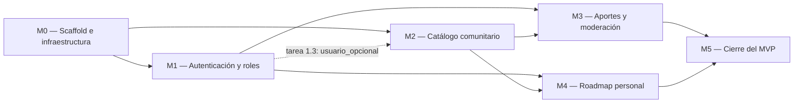

# Implementation Plan — Rumbo

> **Qué es:** el orden de construcción. Módulos, dependencias, tareas con su Definition of Done
> (DoD) verificable y estimaciones. Es lo que se ejecuta en la Instancia B, tarea por tarea, rama por rama.
> **Regla de coherencia:** toda historia P0 del [PRD §4](PRD.md#4-user-stories) tiene al menos
> una tarea de backend y una de frontend en este plan (matriz de §1.1).

## 1. MVP — qué es P0

> **Criterio de MVP:** en una máquina limpia, `git clone` + `cp .env.example .env` +
> `docker compose up --build`, cargar datos con
> `docker compose exec backend uv run python -m app.semillas.cargar_demo`, y recorrer de punta a
> punta las siguientes historias en `http://localhost:5173` **sin errores en la consola del
> navegador ni respuestas 500** en los logs del backend:

- **US-001** — Registro de usuario.
- **US-002** — Login con rate limiting y logout.
- **US-003** — Catálogo comunitario paginado con búsqueda y filtro por categoría.
- **US-004** — Detalle de curso.
- **US-005** — Aportar un curso con metadatos y declaración de toma.
- **US-006** — Moderación: aprobar o rechazar aportes.
- **US-007** — Agregar un curso al roadmap.
- **US-008** — Ver roadmap paginado, cambiar estado de avance y quitar ítems.
- **US-009** — Recuperación de contraseña de ciclo completo.
- **US-010** — Ver el estado de mis aportes.

**P1 (entran si el tiempo lo permite, sin bloquear el MVP):** US-011 reordenar roadmap (tareas
4.3 y 4.6) y US-012 filtros por atributos (tareas 2.4 y 2.8).

**Pregunta de cierre — "¿el lunes a la noche funciona esto?":** sí, si y solo si los 10 casos
del checklist de la tarea 5.1 están tildados.

### 1.1 Trazabilidad historia → tareas

| Historia | Prioridad | Backend | Frontend | Verificación E2E |
|----------|-----------|---------|----------|------------------|
| US-001 | P0 | 1.1, 1.2 | 1.8, 1.9 | 5.1 caso 1 |
| US-002 | P0 | 1.3, 1.4 | 1.8, 1.9 | 5.1 caso 2 |
| US-003 | P0 | 2.1, 2.2, 2.3 | 2.6, 2.7 | 5.1 caso 3 |
| US-004 | P0 | 2.5 | 2.9 | 5.1 caso 4 |
| US-005 | P0 | 3.1, 3.2 | 3.5 | 5.1 caso 5 |
| US-006 | P0 | 3.4 | 3.7 | 5.1 caso 6 |
| US-007 | P0 | 4.1 | 4.4 | 5.1 caso 7 |
| US-008 | P0 | 4.1, 4.2 | 4.5 | 5.1 caso 8 |
| US-009 | P0 | 1.6, 1.7 | 1.10 | 5.1 caso 9 |
| US-010 | P0 | 3.3 | 3.6 | 5.1 caso 10 |
| US-011 | P1 | 4.3 | 4.6 | — |
| US-012 | P1 | 2.4 | 2.8 | — |

## 2. Módulos y dependencias

| Dependencia | Por qué es real |
|-------------|-----------------|
| M0 → todo | sin Compose, migración, shell ni componentes compartidos no hay dónde construir nada |
| M1 → M3, M4 | aportar, moderar y gestionar el roadmap requieren sesión y rol |
| M1 ⇢ M2 (parcial) | el catálogo es público, pero `en_mi_roadmap` necesita la dependencia `usuario_opcional` (1.3); el resto de M2 se puede hacer en paralelo con M1 |
| M2 → M3 | el formulario usa categorías (2.2) y "Ver en el catálogo" necesita el detalle (2.5, 2.9) |
| M2 → M4 | solo se agregan al roadmap cursos publicados, desde el catálogo y el detalle |
| M3, M4 → M5 | el cierre recorre todas las historias |

**Orden de ejecución sugerido:** M0 → M1 (hasta 1.3) → M2 en paralelo con el resto de M1 → M3 → M4 → M5.
**Estimación total:** M0 13 h · M1 17 h · M2 13 h · M3 16 h · M4 11 h · M5 6 h = **76 h**
(P1 incluidas: 5 h de ese total).

## 3. Detalle por módulo

> Columnas: **DoD** = qué tiene que ser cierto para dar la tarea por hecha; **Verificación** =
> comando, URL o acción que lo demuestra. Los comandos asumen el stack levantado con
> `docker compose up -d` desde la raíz del repo.

### M0 — Scaffold e infraestructura

| # | Tarea | DoD | Verificación | Est. | US |
|---|-------|-----|--------------|------|----|
| 0.1 | Registrar versiones locales y crear el árbol de carpetas de TRD §3.2 con `.env.example` | el árbol existe (con `.gitkeep` donde haga falta); `.env.example` tiene todas las variables de TRD §4.4; SPEC §6 y TRD §1 reflejan las versiones reales instaladas | `node -v && pnpm -v && uv --version && docker version --format '{{.Server.Version}}' && docker compose version`; `git ls-files backend frontend` | 1 h | — |
| 0.2 | `docker-compose.yml` con `postgres:18.6`, volumen `pgdata` en `/var/lib/postgresql`, healthcheck y creación de `rumbo_test` | el contenedor queda `healthy`; versión 18.6; existe `rumbo_test`; los datos sobreviven a `down`/`up` (R-02) | `docker compose up -d postgres && docker compose ps` (healthy) · `docker compose exec postgres psql -U rumbo -c "show server_version;"` → `18.6` · `\l` lista `rumbo_test` | 1 h | — |
| 0.3 | Backend mínimo: `pyproject.toml` con `uv`, `config.py`, logging JSON con `request_id`, `GET /api/v1/health` (E01) que prueba la BD, Dockerfile | `uv sync` sin errores; `uv.lock` versionado; health responde 200 con `{"estado":"ok","bd":"ok"}` y header `X-Request-ID`; log JSON por request | `curl -i http://localhost:8000/api/v1/health` · `docker compose logs backend` | 1,5 h | — |
| 0.4 | `compartido/` del backend: excepciones de dominio + handlers problem+json (incluido el 422 de FastAPI traducido) + `ParamsPaginacion` / `Pagina[T]` | `page_size=101` → 422 con `code: validacion_fallida` y `errors[0].campo == "page_size"`; tests unitarios de paginación (`pages`, página fuera de rango) | `docker compose exec backend uv run pytest tests/unitarios/compartido -q` | 1,5 h | — |
| 0.5 | Alembic + migración `0001_esquema_inicial`: 3 enums, 6 tablas, constraints, índices (parcial de URL, trigram, `DEFERRABLE`), extensión `pg_trgm`, 13 categorías; modelos ORM en `models.py` de cada dominio | `alembic upgrade head` y `downgrade base` sin errores; el esquema coincide con BackendSchema §1.3 | `docker compose exec backend uv run alembic upgrade head` · `docker compose exec postgres psql -U rumbo -c "\d+ cursos"` · `psql -c "select count(*) from categorias;"` → 13 | 2 h | — |
| 0.6 | Frontend: Vite + React 19.2 con pnpm 11.18 (Corepack), proxy `/api`, `react-router` con todas las rutas de APPFlow §2 como placeholders, `tokens.css`, `base.css`, fuentes Roboto y Material Symbols self-hosted, Dockerfile | `pnpm dev` muestra el shell; cada ruta de APPFlow §2 renderiza su `<h1>`; `/api/v1/health` responde a través del proxy | abrir `http://localhost:5173/catalogo` · `curl http://localhost:5173/api/v1/health` → 200 | 1,5 h | — |
| 0.7 | Header + drawer accesible (UX-UI §4.6) y componentes base de `compartido/ui`: Boton, CampoTexto, Select, GrupoSiNo, Chip, Paginador, Modal, Snackbar, Skeleton, EstadoVacio, BannerError; `stylelint` con regla anti `max-width` | a 360px el drawer abre, atrapa el foco, cierra con `ESC`/scrim/link y devuelve el foco; a 1024px se ve la nav horizontal; `pnpm lint:css` pasa y falla si se agrega `@media (max-width: …)` | DevTools en 360/1024px + teclado · `docker compose exec frontend pnpm lint:css` · `docker compose exec frontend pnpm test -- MenuLateral` | 3 h | — (RNF-002, RNF-003) |
| 0.8 | Cliente HTTP `compartido/api/cliente.js`: `credentials: 'include'`, parseo de problem+json en un `ErrorApi` con `status`, `code`, `errors`, manejo global de 401 | tests: 422 expone `errors`; 401 dispara el evento de sesión expirada; error de red se distingue de error HTTP | `docker compose exec frontend pnpm test -- cliente` | 1 h | — |
| 0.9 | Compose completo (`postgres`, `backend`, `frontend`, `mailpit`) con `depends_on` por healthcheck y sección "Cómo levantar" en el README | `docker compose up --build` desde cero deja los 4 servicios arriba y el backend con migraciones aplicadas | `docker compose down -v && docker compose up --build -d && docker compose ps` | 0,5 h | — |

### M1 — Autenticación y roles

| # | Tarea | DoD | Verificación | Est. | US |
|---|-------|-----|--------------|------|----|
| 1.1 | `auth/seguridad.py` (Argon2id con `pwdlib`, perfil reducido para tests R-03; firma/verificación JWT; armado de cookie) + `auth/repository.py` de usuarios | tests unitarios: hash empieza con `$argon2id$`, verificar ok/falla, JWT vencido y `tv` distinto → inválido; búsqueda por `lower(email)` | `docker compose exec backend uv run pytest tests/unitarios/auth -q` | 2 h | US-001, US-002 |
| 1.2 | Service de registro + `POST /api/v1/auth/registro` (E02) con BR-013 | 201 con `Usuario` y `Set-Cookie: rumbo_sesion` HttpOnly; email repetido en otra capitalización → 409 `email_duplicado`; contraseña de 9 caracteres → 422 | `curl -i -X POST localhost:8000/api/v1/auth/registro -H 'Content-Type: application/json' -d '{"nombre":"Lucía","email":"lucia@example.com","password":"unaFraseLarga2026"}'` · `pytest tests/integracion/auth -k registro` | 1,5 h | US-001 |
| 1.3 | `POST /api/v1/auth/login` (E03), `POST /api/v1/auth/logout` (E04), `GET /api/v1/auth/me` (E05) + dependencias `usuario_actual`, `usuario_opcional`, `requiere_rol` | login ok setea cookie; credenciales inválidas → 401 `credenciales_invalidas` con el mismo cuerpo exista o no el email; `me` con cookie → 200, sin cookie → 401; logout borra la cookie | `curl -i -c c.txt …/auth/login …` · `curl -i -b c.txt localhost:8000/api/v1/auth/me` · `pytest tests/integracion/auth -k "login or me or logout"` | 2 h | US-002 |
| 1.4 | Rate limiting con `slowapi` (TD-004) en E02, E03, E06, E07 + handler 429 problem+json con `reintentar_en` | el 6.º login en un minuto desde la misma IP → 429 con `Retry-After` y `X-RateLimit-*`; los 5 primeros responden según credenciales | `for i in 1 2 3 4 5 6; do curl -s -o /dev/null -w "%{http_code}\n" -X POST localhost:8000/api/v1/auth/login -H 'Content-Type: application/json' -d '{"email":"x@x.com","password":"y"}'; done` → `401 ×5, 429` · `pytest -k rate_limit` | 1,5 h | US-002 |
| 1.5 | Seed de admin (lee `ADMIN_EMAIL`/`ADMIN_PASSWORD`) + comando `promover` (TD-008) | el admin puede loguearse; `promover martin@example.com moderador` cambia el rol; email inexistente → mensaje de error y código de salida 1 | `docker compose exec backend uv run python -m app.auth.cli promover martin@example.com moderador` · `psql -c "select email, rol from usuarios;"` | 1 h | US-006 |
| 1.6 | Servicio `mailpit` + `POST /api/v1/auth/recuperar` (E06): invalida tokens previos, guarda SHA-256, envía email | siempre 202 con el mismo cuerpo; para un email existente aparece el email en Mailpit con enlace `…/restablecer?token=`; en BD solo hay hash de 64 caracteres; pedir otro invalida el anterior | `curl -i -X POST …/auth/recuperar -d '{"email":"lucia@example.com"}' …` · abrir `http://localhost:8025` · `psql -c "select token_hash, usado_en from tokens_recuperacion;"` | 2 h | US-009 |
| 1.7 | `POST /api/v1/auth/restablecer` (E07): valida token, actualiza hash, incrementa `token_version`, marca usado | token válido → 204 y una cookie de sesión anterior pasa a dar 401 en `/me`; token usado o vencido → 400 `token_invalido`; contraseña corta → 422 | `pytest tests/integracion/auth -k restablecer` (incluye caso con reloj adelantado 31 min) | 1,5 h | US-009 |
| 1.8 | Frontend: `useSesion` (E05 al iniciar), proveedor de sesión, `RutaProtegida`, `RutaConRol`, menú de cuenta y logout, manejo global de 401 (APPFlow §5) | sin sesión `/roadmap` redirige a `/login?volver=%2Froadmap`; con sesión muestra el nombre en el header; logout vuelve a `/`; un 401 en cualquier query muestra el snackbar "Tu sesión expiró" | recorrido manual + `docker compose exec frontend pnpm test -- useSesion RutaProtegida` | 2 h | US-001, US-002 |
| 1.9 | Pantallas Login y Registro con todos los estados de APPFlow §3.4 y §3.5 (incluida la cuenta regresiva del 429) | cada estado de la ficha se puede provocar y se ve como en UX-UI; el error 409 aparece en el campo email; tras el 6.º intento el botón queda deshabilitado con cuenta regresiva | recorrido manual en 360px y 1280px | 2 h | US-001, US-002 |
| 1.10 | Pantallas Recuperar y Restablecer (APPFlow §3.6, §3.7) + prueba de la cookie a través del proxy (R-05) | ciclo completo desde la UI: pedir enlace → Mailpit → restablecer → login con la nueva contraseña; el token desaparece de la barra de direcciones | recorrido manual con Mailpit; DevTools → Application → Cookies muestra `rumbo_sesion` HttpOnly en `localhost:5173` | 1,5 h | US-009 |

### M2 — Catálogo comunitario

| # | Tarea | DoD | Verificación | Est. | US |
|---|-------|-----|--------------|------|----|
| 2.1 | Script `semillas/cargar_demo.py` (TD-015): admin, 2 usuarios demo (uno moderador), 40 cursos publicados en ≥ 8 categorías y ≥ 5 plataformas, 5 aportes en revisión, 2 rechazados; flag `--cursos N` | idempotente (correrlo 2 veces no duplica); cuentas en TRD/README | `docker compose exec backend uv run python -m app.semillas.cargar_demo` (×2) · `psql -c "select estado, count(*) from cursos group by estado;"` → 40 / 5 / 2 | 1,5 h | US-003 |
| 2.2 | `GET /api/v1/categorias` (E08) paginado | 13 categorías ordenadas por `orden`; `page_size=100` devuelve todas; `page_size=0` → 422 | `curl 'localhost:8000/api/v1/categorias?page=1&page_size=100'` · `pytest tests/integracion/catalogo -k categorias` | 0,5 h | US-003, US-005 |
| 2.3 | `GET /api/v1/cursos` (E09): solo publicados, `q` (≥ 2 caracteres), `categoria_id`, `orden`, paginación, `en_mi_roadmap` con `usuario_opcional` | 20 ítems por defecto ordenados por `publicado_en DESC, id DESC`; `q=do` → 422; nunca aparecen `en_revision`/`rechazado`; `en_mi_roadmap` es `null` sin cookie | `curl 'localhost:8000/api/v1/cursos?q=docker&categoria_id=4&page=1'` · `pytest tests/integracion/catalogo -k listado` | 2 h | US-003 |
| 2.4 | **(P1)** Filtros `con_certificado`, `con_examen`, `con_cuestionarios`, `con_aval` en E09 | cada filtro aplica igualdad; combinados aplican AND; ausente = sin filtro | `curl 'localhost:8000/api/v1/cursos?con_certificado=true&con_examen=false'` · `pytest -k filtros_atributos` | 1 h | US-012 |
| 2.5 | `GET /api/v1/cursos/{curso_id}` (E10) con `aportante`, `cantidad_en_roadmaps`, `roadmap_item_id` | publicado → 200 con todos los campos de BackendSchema §3.2; en revisión o inexistente → 404 `no_encontrado` | `curl -i localhost:8000/api/v1/cursos/1` · `pytest -k detalle` | 1 h | US-004 |
| 2.6 | Componente `CardCurso` (UX-UI §4.3, incluido skeleton) + `HomePage` (APPFlow §3.1) | la card muestra todos los campos y atributos con icono + texto; Home muestra 6 cursos y el buscador lleva a `/catalogo?q=…`; empty y error diseñados | recorrido manual + `pnpm test -- CardCurso` | 2 h | US-003 |
| 2.7 | `CatalogoPage` (APPFlow §3.2): búsqueda, select de categoría, orden, paginador, estados, filtros sincronizados con la URL (`usePaginacionUrl`) | recargar o usar "atrás" restaura filtros y página; cambiar un filtro vuelve a `page=1`; la página anterior se atenúa mientras carga; contador "1–20 de N" correcto | recorrido manual + `pnpm test -- usePaginacionUrl` | 3 h | US-003 |
| 2.8 | **(P1)** Chips de filtro por atributos en el catálogo | cada chip alterna `aria-pressed` y actualiza la URL; en base se agrupan en "Filtros (n)" | recorrido manual en 360px y 1024px | 1 h | US-012 |
| 2.9 | `DetalleCursoPage` (APPFlow §3.3) | todos los campos de US-004 visibles; "Ir al curso" abre pestaña nueva con `rel="noopener noreferrer"`; 404 muestra "Curso no encontrado"; layout 2 columnas desde 1024px | recorrido manual | 1 h | US-004 |

### M3 — Aportes y moderación

| # | Tarea | DoD | Verificación | Est. | US |
|---|-------|-----|--------------|------|----|
| 3.1 | `aportes/normalizacion_url.py`: función pura con las 8 reglas de BackendSchema §4 | ≥ 15 casos de test (mayúsculas, `www`, `utm_*`, fragmento, barra final, puerto, orden de query, `http`↔`https`, URL ya normalizada) | `docker compose exec backend uv run pytest tests/unitarios/aportes -k normalizacion -q` | 1,5 h | US-005 |
| 3.2 | Service de aportes + `POST /api/v1/aportes` (E11) con BR-002, BR-003, BR-006 y validaciones de BackendSchema §3.3 | 201 crea curso `en_revision` + aporte en una transacción, con header `Location`; URL duplicada publicada → 409 con `curso_existente_id`; en revisión → 409 con `curso_existente_id: null`; URL de un rechazado → 201; aval sin organización → 422 | `curl -i -b c.txt -X POST localhost:8000/api/v1/aportes -H 'Content-Type: application/json' -d @aporte.json` · `pytest tests/unitarios/aportes tests/integracion/aportes -k crear` | 2,5 h | US-005 |
| 3.3 | `GET /api/v1/aportes/mios` (E12) y `GET /api/v1/aportes/{aporte_id}` (E13) con autorización autor/moderador | mis aportes paginados del más nuevo al más viejo con filtro `estado`; aporte ajeno para un usuario → 404; para moderador → 200 con `es_propio: false` | `pytest tests/integracion/aportes -k "mios or detalle"` | 1,5 h | US-010, US-006 |
| 3.4 | `GET /api/v1/moderacion/aportes` (E14), `POST …/aprobar` (E15), `POST …/rechazar` (E16) con BR-005, BR-007, BR-008, BR-014 | usuario sin rol → 403; aprobar propio → 403 `autovalidacion_no_permitida`; aprobar ajeno → curso `publicado` con `publicado_en` y `enlace_verificado_en`; segunda decisión → 409; motivo de 9 caracteres → 422; test de concurrencia con dos sesiones | `pytest tests/integracion/aportes -k moderacion` · curso aprobado visible en `GET /api/v1/cursos` | 3 h | US-006 |
| 3.5 | `AportarPage` (APPFlow §3.9): 4 secciones, esquema zod espejo del backend, `CampoDocentes` (1–10), organización condicional, resumen de errores, borrador en `sessionStorage` ante 401, mapeo de 409/422 a campos | un aporte válido redirige a `/mis-aportes/:id` con snackbar; Sí/No sin responder bloquean el envío; 409 muestra link al curso existente; un 422 forzado se muestra en el campo correcto | recorrido manual + `pnpm test -- aporteNuevo FormAporte` | 4 h | US-005 |
| 3.6 | `MisAportesPage` y `EstadoAportePage` (APPFlow §3.10, §3.11) | lista paginada con chips de estado; rechazado muestra motivo; publicado enlaza al catálogo; tabla en ≥ 768px, cards en base | recorrido manual con los datos del seed | 1,5 h | US-010 |
| 3.7 | `BandejaModeracionPage` y `RevisionAportePage` (APPFlow §3.12, §3.13) con checkbox de verificación y modal de rechazo | aprobar requiere el checkbox; rechazar requiere motivo 10–500 con contador; propio con botones deshabilitados y texto explicativo; 409 muestra "Este aporte ya fue moderado"; la bandeja se actualiza al volver | recorrido manual con usuario moderador del seed | 2 h | US-006 |

### M4 — Roadmap personal

| # | Tarea | DoD | Verificación | Est. | US |
|---|-------|-----|--------------|------|----|
| 4.1 | Service de roadmap + `GET /api/v1/roadmap/items` (E17, con `resumen` y filtro `estado`) + `POST /api/v1/roadmap/items` (E18) con BR-004, BR-016 | agregar → 201 al final con `pendiente`; repetido → 409 con `item_id`; curso no publicado → 404; listado ordenado por `orden`; `resumen` independiente del filtro | `pytest tests/unitarios/roadmap tests/integracion/roadmap -k "listar or agregar"` | 2 h | US-007, US-008 |
| 4.2 | `PATCH /api/v1/roadmap/items/{item_id}` (E19, campo `estado`) y `DELETE` (E20) con compactación | `completado` setea `completado_en` y salir de él lo borra (BR-011); borrar el 2.º de 4 deja órdenes 1,2,3; ítem ajeno → 404 | `pytest tests/integracion/roadmap -k "estado or quitar"` | 1,5 h | US-008 |
| 4.3 | **(P1)** `PATCH …` con `orden`: mover arriba/abajo/a extremos usando la constraint diferida | mover el 4.º a la posición 1 deja `[4,1,2,3]` en orden; `orden` fuera de rango → 422; sin violaciones de unicidad | `pytest tests/unitarios/roadmap tests/integracion/roadmap -k reordenar` | 1,5 h | US-011 |
| 4.4 | `BotonAgregarRoadmap` en card y detalle: estados, snackbar con "Deshacer" (E20), redirección a login con `volver` | sin sesión lleva a `/login?volver=/catalogo/57` y al volver muestra el detalle; agregar invalida las queries de catálogo y roadmap; "Deshacer" lo quita | recorrido manual (Flujo 4 del APPFlow) | 1,5 h | US-007 |
| 4.5 | `RoadmapPage` (APPFlow §3.8): resumen de avance, chips de estado, `ItemRoadmap` con select optimista, modal para quitar, paginador y estados vacíos | cambiar el estado actualiza el resumen sin recargar; si la API falla se revierte con snackbar; quitar el último de una página navega a la anterior | recorrido manual + `pnpm test -- useActualizarItem` | 3 h | US-008 |
| 4.6 | **(P1)** Botones Subir/Bajar con anuncio `aria-live` y foco en el ítem movido | extremos deshabilitados; deshabilitados con filtro activo; el orden persiste al recargar | recorrido manual solo con teclado | 1,5 h | US-011 |

### M5 — Cierre del MVP

| # | Tarea | DoD | Verificación | Est. | US |
|---|-------|-----|--------------|------|----|
| 5.1 | Recorrido E2E en clon limpio con el checklist de los 10 casos (abajo) | los 10 casos tildados, sin errores en consola ni 500 en logs | `git clone … && cp .env.example .env && docker compose up --build`, seed, checklist | 2 h | US-001…US-010 |
| 5.2 | Auditoría de accesibilidad y mobile-first | Lighthouse Accesibilidad ≥ 95 en Home, Catálogo, Aportar y Roadmap; recorrido completo solo con teclado; sin scroll horizontal a 360px; layout correcto a 768 y 1280px; `pnpm lint:css` sin errores | Lighthouse (modo mobile) · DevTools responsive | 2 h | RNF-002, RNF-005 |
| 5.3 | Prueba de rendimiento del catálogo con 1.000 cursos | p95 de `GET /api/v1/cursos?q=data&page=3` < 300 ms en 200 requests; `EXPLAIN ANALYZE` usa los índices de BackendSchema §1.3 | `cargar_demo --cursos 1000` · `hey -n 200 -c 10 'http://localhost:8000/api/v1/cursos?q=data&page=3'` · `psql -c "EXPLAIN ANALYZE …"` | 1 h | RNF-006 |
| 5.4 | Cierre documental: README (cómo levantar, cuentas demo), historial de SPEC §9, tabla de §4 completa, tag `v0.2.0-mvp` | docs coherentes con lo construido; tag publicado | revisión del PR `docs/cierre-mvp` · `git tag --list` | 1 h | — |

**Checklist E2E de la tarea 5.1** (cada caso con el usuario indicado del seed):

1. [ ] US-001 — Registrar `nueva@example.com`; aparece en `/roadmap` con sesión.
2. [ ] US-002 — Cerrar sesión, ingresar; 6 intentos fallidos muestran la cuenta regresiva.
3. [ ] US-003 — Buscar "python" + categoría, navegar a la página 2 y volver con "atrás".
4. [ ] US-004 — Abrir un detalle; "Ir al curso" abre pestaña nueva; `/catalogo/99999` muestra 404.
5. [ ] US-005 — Aportar un curso válido; reintentar la misma URL con `?utm_source=x` → duplicado.
6. [ ] US-006 — Como moderador, aprobar el aporte del caso 5 (aparece en el catálogo) y rechazar otro con motivo.
7. [ ] US-007 — Sin sesión, "Agregar" en un detalle → login → agregar; "Deshacer" lo quita; agregar de nuevo.
8. [ ] US-008 — En `/roadmap`, pasar un ítem a "Completado", filtrar por estado, quitar otro.
9. [ ] US-009 — Recuperar contraseña vía Mailpit, restablecer, verificar que la sesión vieja da 401, ingresar.
10. [ ] US-010 — Como autor, ver en `/mis-aportes` el publicado (link al catálogo) y el rechazado (motivo).

## 4. Ejecución (Instancia B)

> **Regla:** 1 tarea (o lote coherente) = 1 rama según el flujo del README + PR con squash merge
> y título en Conventional Commits. Se actualiza esta tabla en el mismo PR que cierra la tarea.

| # | Tarea | Módulo | Estado | Rama | Commit (título del PR) |
|---|-------|--------|--------|------|------------------------|
| 0.1 | Versiones y árbol de carpetas | M0 | [ ] | `chore/m0-estructura` | `chore(infra): crear estructura de carpetas y .env.example` |
| 0.2 | Compose con Postgres 18.6 | M0 | [ ] | `docker/m0-postgres` | `docker(infra): agregar postgres 18.6 con volumen y healthcheck` |
| 0.3 | Backend mínimo + health | M0 | [ ] | `feat/m0-backend-health` | `feat(compartido): crear app fastapi con health y logging json` |
| 0.4 | Errores y paginación compartidos | M0 | [ ] | `feat/m0-errores-paginacion` | `feat(compartido): agregar problem+json y paginación offset` |
| 0.5 | Migración inicial | M0 | [ ] | `feat/m0-migracion-inicial` | `feat(infra): crear esquema inicial con alembic` |
| 0.6 | Frontend shell + tokens | M0 | [ ] | `feat/m0-frontend-shell` | `feat(compartido): crear shell react con rutas y tokens` |
| 0.7 | Header, drawer y UI base | M0 | [ ] | `feat/m0-ui-base` | `feat(compartido): agregar drawer accesible y componentes base` |
| 0.8 | Cliente HTTP | M0 | [ ] | `feat/m0-cliente-http` | `feat(compartido): agregar cliente http con problem+json` |
| 0.9 | Compose completo | M0 | [ ] | `docker/m0-compose-completo` | `docker(infra): levantar los cuatro servicios con un comando` |
| 1.1 | Seguridad y repositorio de usuarios | M1 | [ ] | `feat/m1-seguridad` | `feat(auth): agregar hash argon2id y jwt en cookie` |
| 1.2 | Registro | M1 | [ ] | `feat/m1-registro` | `feat(auth): permitir registro de usuarios` |
| 1.3 | Login, logout, me | M1 | [ ] | `feat/m1-login` | `feat(auth): agregar login, logout y sesión actual` |
| 1.4 | Rate limiting | M1 | [ ] | `feat/m1-rate-limit` | `feat(auth): limitar intentos de login con slowapi` |
| 1.5 | Seed admin y promover | M1 | [ ] | `feat/m1-roles` | `feat(auth): crear admin inicial y comando promover` |
| 1.6 | Solicitud de recuperación | M1 | [ ] | `feat/m1-recuperar` | `feat(auth): enviar enlace de recuperación por email` |
| 1.7 | Restablecer contraseña | M1 | [ ] | `feat/m1-restablecer` | `feat(auth): restablecer contraseña e invalidar sesiones` |
| 1.8 | Sesión y guardas en frontend | M1 | [ ] | `feat/m1-sesion-frontend` | `feat(auth): agregar sesión, guardas de ruta y logout` |
| 1.9 | Pantallas login y registro | M1 | [ ] | `feat/m1-pantallas-acceso` | `feat(auth): agregar pantallas de login y registro` |
| 1.10 | Pantallas recuperar y restablecer | M1 | [ ] | `feat/m1-pantallas-recuperacion` | `feat(auth): agregar pantallas de recuperación de contraseña` |
| 2.1 | Seed de demo | M2 | [ ] | `feat/m2-seed-demo` | `feat(catalogo): agregar script de datos de demo` |
| 2.2 | Categorías | M2 | [ ] | `feat/m2-categorias` | `feat(catalogo): exponer categorías paginadas` |
| 2.3 | Listado de cursos | M2 | [ ] | `feat/m2-listado-cursos` | `feat(catalogo): listar cursos publicados con búsqueda` |
| 2.4 | Filtros por atributos (P1) | M2 | [ ] | `feat/m2-filtros-atributos` | `feat(catalogo): filtrar por certificado, examen y aval` |
| 2.5 | Detalle de curso API | M2 | [ ] | `feat/m2-detalle-curso` | `feat(catalogo): exponer detalle de curso publicado` |
| 2.6 | Card de curso y Home | M2 | [ ] | `feat/m2-home` | `feat(catalogo): agregar card de curso y home` |
| 2.7 | Pantalla de catálogo | M2 | [ ] | `feat/m2-pantalla-catalogo` | `feat(catalogo): agregar catálogo con filtros en la url` |
| 2.8 | Chips de atributos (P1) | M2 | [ ] | `feat/m2-chips-atributos` | `feat(catalogo): agregar chips de filtro por atributos` |
| 2.9 | Pantalla de detalle | M2 | [ ] | `feat/m2-pantalla-detalle` | `feat(catalogo): agregar pantalla de detalle de curso` |
| 3.1 | Normalización de URL | M3 | [ ] | `feat/m3-normalizacion-url` | `feat(aportes): normalizar urls para detectar duplicados` |
| 3.2 | Crear aporte | M3 | [ ] | `feat/m3-crear-aporte` | `feat(aportes): permitir aportar cursos a revisión` |
| 3.3 | Mis aportes y detalle API | M3 | [ ] | `feat/m3-mis-aportes-api` | `feat(aportes): listar mis aportes y su detalle` |
| 3.4 | Moderación API | M3 | [ ] | `feat/m3-moderacion-api` | `feat(aportes): aprobar y rechazar aportes` |
| 3.5 | Formulario de aporte | M3 | [ ] | `feat/m3-formulario-aporte` | `feat(aportes): agregar formulario de aporte` |
| 3.6 | Pantallas de mis aportes | M3 | [ ] | `feat/m3-pantallas-mis-aportes` | `feat(aportes): agregar pantallas de mis aportes` |
| 3.7 | Pantallas de moderación | M3 | [ ] | `feat/m3-pantallas-moderacion` | `feat(aportes): agregar bandeja y revisión de aportes` |
| 4.1 | Listar y agregar al roadmap | M4 | [ ] | `feat/m4-roadmap-api` | `feat(roadmap): listar y agregar cursos al roadmap` |
| 4.2 | Estado y quitar | M4 | [ ] | `feat/m4-estado-quitar` | `feat(roadmap): cambiar estado de avance y quitar ítems` |
| 4.3 | Reordenar API (P1) | M4 | [ ] | `feat/m4-reordenar-api` | `feat(roadmap): permitir reordenar ítems` |
| 4.4 | Botón agregar al roadmap | M4 | [ ] | `feat/m4-boton-agregar` | `feat(roadmap): agregar botón con deshacer en catálogo y detalle` |
| 4.5 | Pantalla mi roadmap | M4 | [ ] | `feat/m4-pantalla-roadmap` | `feat(roadmap): agregar pantalla mi roadmap` |
| 4.6 | Subir/Bajar (P1) | M4 | [ ] | `feat/m4-subir-bajar` | `feat(roadmap): agregar botones subir y bajar accesibles` |
| 5.1 | Recorrido E2E | M5 | [ ] | `test/m5-recorrido-e2e` | `test(infra): registrar recorrido e2e del mvp` |
| 5.2 | Auditoría a11y y mobile-first | M5 | [ ] | `fix/m5-accesibilidad` | `fix(compartido): corregir hallazgos de accesibilidad` |
| 5.3 | Rendimiento del catálogo | M5 | [ ] | `test/m5-rendimiento` | `test(catalogo): medir rendimiento con mil cursos` |
| 5.4 | Cierre documental | M5 | [ ] | `docs/cierre-mvp` | `docs: actualizar documentación al cierre del mvp` |

## 5. Estrategia de testing

> Se **planifica** acá y se **implementa** en la clase del 27/10. Las tareas de §3 ya incluyen los
> tests mínimos que forman parte de su DoD.

### 5.1 Pirámide por capas

| Capa | Qué se prueba | Herramientas | Dónde | Datos |
|------|---------------|--------------|-------|-------|
| **Unitarios — services** | reglas de negocio puras con repositories falsos en memoria y reloj inyectado | `pytest`, patrón AAA | `backend/tests/unitarios/<dominio>/` | fakes, sin BD ni HTTP |
| **Unitarios — funciones puras** | normalización de URL, paginación, armado de JWT, validaciones | `pytest` parametrizado | ídem | tablas de casos |
| **Integración — repositories + routers** | SQL real (constraints, índices parciales, `DEFERRABLE`), autorización, códigos HTTP y cuerpos problem+json | `pytest` + `TestClient` (httpx) contra PostgreSQL 18.6 del Compose, BD `rumbo_test` | `backend/tests/integracion/<dominio>/` | cada test en una transacción con rollback; esquema creado con `alembic upgrade head` al inicio |
| **Frontend — hooks** | estados de carga, paginación con `keepPreviousData`, actualización optimista y reversión, manejo de errores por `code` | Vitest + Testing Library (`renderHook`) con `fetch` mockeado | `frontend/src/features/**/hooks/*.test.js` | respuestas problem+json de ejemplo de BackendSchema |
| **Frontend — componentes críticos** | drawer (foco, ESC, ARIA), formulario de aporte (validación, campos condicionales), paginador | Vitest + Testing Library + `user-event` | junto al componente | — |
| **E2E manual** | historias P0 de punta a punta | checklist de la tarea 5.1 | — | seed de demo |

### 5.2 Casos unitarios mínimos por dominio

- **auth:** hash Argon2id y verificación; JWT vencido / `tv` distinto → inválido; política de
  contraseña (9 vs 10 caracteres, igual al email); token de recuperación vencido, usado y válido;
  pedir un token invalida los anteriores.
- **aportes:** 15+ casos de normalización de URL; aval sin organización → error; organización con
  aval falso → error; año fuera de rango; docentes repetidos; duplicado publicado vs en revisión vs
  rechazado; moderar propio → `AutovalidacionNoPermitida`; moderar no `en_revision` → `AporteYaModerado`; motivo corto.
- **roadmap:** agregar al final (vacío → 1, con 3 → 4); duplicado; curso no publicado; transiciones
  de estado y `completado_en`; mover arriba/abajo/extremos; compactar al borrar.
- **catalogo:** construcción de filtros (combinaciones AND, `q` recortado, booleanos ausentes).

### 5.3 Objetivos de cobertura y comandos

| Ámbito | Objetivo | Comando |
|--------|----------|---------|
| `backend/app/*/service.py` y `normalizacion_url.py` | **≥ 90 %** de líneas | `docker compose exec backend uv run pytest --cov=app --cov-report=term-missing` |
| Backend total | ≥ 80 % | ídem |
| `frontend/src/features/**/hooks` | ≥ 75 % | `docker compose exec frontend pnpm test -- --coverage` |
| Lint | 0 errores | `docker compose exec backend uv run ruff check .` · `docker compose exec frontend pnpm lint && pnpm lint:css` |

### 5.4 Verificación de métricas del PRD con el seed

Consultas que se ejecutan en la tarea 5.1 para demostrar que el modelo sostiene las métricas de PRD §2:
- **O1:** `select estado, count(*) from cursos group by estado;` y `select count(distinct categoria_id), count(distinct plataforma) from cursos where estado = 'publicado';`
- **O2:** mediana de `revisado_en - creado_en` en `aportes` con `percentile_cont(0.5)`.
- **O3:** `select url_normalizada, count(*) from cursos where estado in ('en_revision','publicado') group by 1 having count(*) > 1;` → 0 filas.
- **O4:** usuarios con ≥ 3 ítems y con ≥ 1 `completado` en `roadmap_items`.
- **O5:** proporción de `aportes.lo_tome = true` entre cursos publicados.
- **O6:** `select count(*) from usuarios where password_hash not like '$argon2id$%';` → 0.

## 6. Riesgos del plan

| Riesgo | Impacto | Mitigación |
|--------|---------|------------|
| El formulario de aporte (15 campos, condicionales, lista dinámica, borrador, mapeo de errores) lleva más de las 4 h estimadas | alto: bloquea US-005 y por lo tanto US-006 | esquema zod único reutilizado en validación y tests; se construye primero sin borrador en `sessionStorage` y se agrega al final de la tarea; la moderación (3.4) se prueba antes por API con `curl` |
| Configurar la cookie de sesión a través del proxy de Vite falla y bloquea todo lo que requiere sesión | alto | la tarea 1.10 incluye la verificación explícita (R-05) antes de empezar M3/M4; plan B documentado: CORS con `credentials` entre `:5173` y `:8000` |
| Rate limit, Argon2id o el envío de emails hacen frágiles los tests de integración | medio | perfil de hash reducido en tests (R-03); `limiter.reset()` en un fixture; emisor de email inyectable con un fake en tests |
| Problemas de entorno en Windows (bind mounts, finales de línea, puertos ocupados) | medio | trabajar dentro de WSL2; `.gitattributes` con `eol=lf` en la tarea 0.1; puertos configurables por variables en Compose |
| El reordenamiento del roadmap (P1) consume tiempo del MVP | bajo | US-011 es P1 y queda al final de M4; el MVP se cierra sin ella |
| Subestimación general | medio | colchón implícito: las P1 suman 5 h y son lo primero que se recorta; se revisa el avance contra la tabla de §4 al cerrar cada módulo |
| Cambios de alcance durante la Instancia B | medio | todo cambio pasa por un PR `docs/…` que actualiza SPEC §9 y el PRD antes de tocar código (gestión del cambio, clase 27/10) |

---

**Referencias:**
- Atlassian — Plantilla de plan de proyecto: https://www.atlassian.com/software/confluence/templates/project-plan
- Shape Up — scopes y ciclos: https://basecamp.com/shapeup/
- pytest — How to use fixtures: https://docs.pytest.org/en/stable/how-to/fixtures.html
- Testing Library — Guiding principles: https://testing-library.com/docs/guiding-principles
